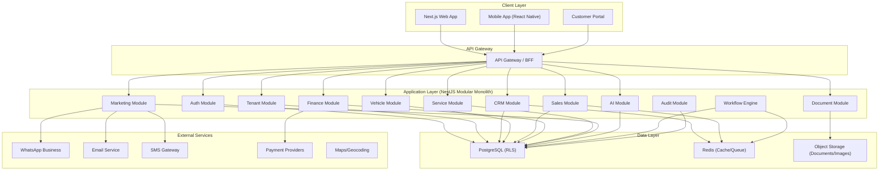
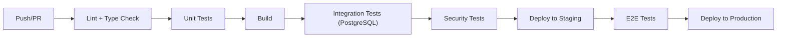

# Universal Car Dealership CRM — Complete Implementation Plan

> **Project:** Universal Dealership CRM & Management Platform  
> **Architecture:** Multi-tenant modular monolith → eventual microservices  
> **Stack:** Next.js 14 (App Router) · NestJS · PostgreSQL · Redis · TypeScript  
> **Generated:** October 2026

---

## Table of Contents

1. [Project Structure & Architecture](#1-project-structure--architecture)
2. [Phase 0 — Foundation Infrastructure](#2-phase-0--foundation-infrastructure)
3. [Phase 1 — Core Platform (Tenant, Auth, Users)](#3-phase-1--core-platform)
4. [Phase 2 — CRM Module (Leads, Customers, Activities)](#4-phase-2--crm-module)
5. [Phase 3 — Vehicle Inventory Module](#5-phase-3--vehicle-inventory)
6. [Phase 4 — Sales Desk Module](#6-phase-4--sales-desk)
7. [Phase 5 — Finance & Transactions Module](#7-phase-5--finance--transactions)
8. [Phase 6 — Documents & Delivery Module](#8-phase-6--documents--delivery)
9. [Phase 7 — After-Sales & Service Module](#9-phase-7--after-sales--service)
10. [Phase 8 — Marketing & Campaigns Module](#10-phase-8--marketing--campaigns)
11. [Phase 9 — AI & Intelligence Module](#11-phase-9--ai--intelligence)
12. [Phase 10 — SaaS Control Plane](#12-phase-10--saas-control-plane)
13. [Complete Database Schema](#13-complete-database-schema)
14. [Complete API Endpoint Map](#14-complete-api-endpoint-map)
15. [Frontend Component Architecture](#15-frontend-component-architecture)
16. [Security Implementation](#16-security-implementation)
17. [Testing Strategy](#17-testing-strategy)
18. [Deployment Architecture](#18-deployment-architecture)

---

## 1. Project Structure & Architecture

### Monorepo Structure

```
car-crm/
├── apps/
│   ├── web/                          # Next.js 14 frontend (App Router)
│   │   ├── app/
│   │   │   ├── (auth)/               # Auth layouts (login, register, forgot-password)
│   │   │   ├── (dashboard)/          # Authenticated dashboard layouts
│   │   │   │   ├── overview/         # Executive workspace
│   │   │   │   ├── crm/             # Leads, customers, activities
│   │   │   │   ├── vehicles/        # Inventory, details, procurement
│   │   │   │   ├── sales/           # Opportunities, quotations, deals
│   │   │   │   ├── finance/         # Receipts, payments, invoices
│   │   │   │   ├── documents/       # KYC, compliance, contracts
│   │   │   │   ├── service/         # Workshop, job cards, parts
│   │   │   │   ├── marketing/       # Campaigns, channels, referrals
│   │   │   │   ├── intelligence/    # AI copilot, reports, forecasts
│   │   │   │   └── settings/        # Organization, users, roles
│   │   │   ├── admin/               # SaaS platform admin
│   │   │   └── api/                 # Next.js API routes (BFF proxy)
│   │   ├── components/
│   │   │   ├── ui/                  # Base UI components (buttons, inputs, modals)
│   │   │   ├── layout/             # Shell, sidebar, header, navigation
│   │   │   ├── data-table/         # Reusable data table with filters, pagination
│   │   │   ├── forms/              # Form primitives and field renderers
│   │   │   ├── charts/             # Dashboard chart components
│   │   │   ├── timeline/           # Activity timeline component
│   │   │   └── shared/             # Shared composite components
│   │   ├── hooks/                   # Custom React hooks
│   │   ├── lib/                     # Utilities, API client, auth helpers
│   │   ├── stores/                  # Zustand state management
│   │   └── styles/                  # Global CSS, design tokens
│   │
│   └── api/                         # NestJS backend API
│       ├── src/
│       │   ├── common/              # Shared utilities, decorators, guards
│       │   │   ├── auth/            # JWT strategy, guards, tenant context
│       │   │   ├── database/        # TypeORM/Prisma setup, migrations
│       │   │   ├── decorators/      # Custom decorators (@TenantId, @CurrentUser)
│       │   │   ├── filters/         # Exception filters
│       │   │   ├── guards/          # Auth, permission, tenant guards
│       │   │   ├── interceptors/    # Audit, logging, transform interceptors
│       │   │   ├── middleware/      # Tenant resolution, request ID
│       │   │   └── pipes/           # Validation, sanitization pipes
│       │   ├── modules/
│       │   │   ├── tenant/          # Tenant management
│       │   │   ├── auth/            # Authentication & session
│       │   │   ├── user/            # User & membership management
│       │   │   ├── permission/      # RBAC & permission checks
│       │   │   ├── branch/          # Branch management
│       │   │   ├── customer/        # Customer 360
│       │   │   ├── lead/            # Lead & enquiry management
│       │   │   ├── activity/        # Activities & timeline
│       │   │   ├── vehicle/         # Vehicle inventory
│       │   │   ├── vehicle-catalog/ # Vehicle specifications catalog
│       │   │   ├── procurement/     # Procurement & trade-in
│       │   │   ├── opportunity/     # Opportunity management
│       │   │   ├── quotation/       # Quotation builder
│       │   │   ├── deal/            # Deal management
│       │   │   ├── booking/         # Booking & reservation
│       │   │   ├── payment/         # Payment processing
│       │   │   ├── invoice/         # Invoice generation
│       │   │   ├── refund/          # Refund processing
│       │   │   ├── document/        # Document management
│       │   │   ├── delivery/        # PDI & delivery
│       │   │   ├── service/         # After-sales service
│       │   │   ├── marketing/       # Campaign management
│       │   │   ├── notification/    # Notification service
│       │   │   ├── workflow/        # Workflow engine
│       │   │   ├── custom-field/    # Custom field definitions
│       │   │   ├── audit/           # Audit logging
│       │   │   ├── report/          # Reporting & analytics
│       │   │   ├── ai/              # AI copilot service
│       │   │   ├── integration/     # External integrations
│       │   │   └── saas/            # SaaS control plane
│       │   └── main.ts
│       ├── prisma/
│       │   ├── schema.prisma        # Prisma schema
│       │   └── migrations/          # Database migrations
│       └── test/
│
├── packages/
│   ├── shared-types/                # Shared TypeScript types/interfaces
│   ├── validators/                  # Shared validation schemas (Zod)
│   └── business-rules/             # Shared business logic (state machines, calculations)
│
├── docker-compose.yml               # Development environment
├── turbo.json                       # Turborepo configuration
└── package.json                     # Workspace root
```

### Architecture Diagram



---

## 2. Phase 0 — Foundation Infrastructure

### 2.1 Project Initialization

#### Step 1: Create monorepo

```bash
# Initialize workspace
mkdir car-crm && cd car-crm
npm init -y
npx -y turbo@latest init

# Create Next.js frontend
cd apps
npx -y create-next-app@latest web --typescript --tailwind --eslint --app --src-dir --import-alias "@/*" ./web

# Create NestJS backend
npx -y @nestjs/cli new api --package-manager npm --skip-git
```

#### Step 2: Shared packages setup

Create shared TypeScript types, Zod validators, and business rule packages that both frontend and backend consume.

### 2.2 Database Setup

#### Docker Compose for development

```yaml
# docker-compose.yml
version: '3.9'
services:
  postgres:
    image: postgres:16-alpine
    environment:
      POSTGRES_DB: car_crm
      POSTGRES_USER: crm_admin
      POSTGRES_PASSWORD: dev_password
    ports:
      - "5432:5432"
    volumes:
      - pgdata:/var/lib/postgresql/data
    
  redis:
    image: redis:7-alpine
    ports:
      - "6379:6379"
    
  minio:
    image: minio/minio:latest
    command: server /data --console-address ":9001"
    environment:
      MINIO_ROOT_USER: minioadmin
      MINIO_ROOT_PASSWORD: minioadmin
    ports:
      - "9000:9000"
      - "9001:9001"

volumes:
  pgdata:
```

### 2.3 Design System Foundation

Create the CSS design system with tokens, variables, and base component styles before any UI work begins.

```css
/* Global Design Tokens */
:root {
  /* Color Palette — Premium automotive dark theme */
  --color-bg-primary: hsl(222, 47%, 8%);
  --color-bg-secondary: hsl(222, 35%, 12%);
  --color-bg-tertiary: hsl(222, 30%, 16%);
  --color-bg-elevated: hsl(222, 35%, 14%);
  --color-bg-glass: hsla(222, 35%, 18%, 0.6);
  
  --color-surface: hsl(222, 25%, 18%);
  --color-surface-hover: hsl(222, 25%, 22%);
  --color-surface-active: hsl(222, 25%, 14%);
  
  --color-border: hsl(222, 20%, 24%);
  --color-border-subtle: hsl(222, 15%, 20%);
  
  --color-text-primary: hsl(210, 40%, 96%);
  --color-text-secondary: hsl(215, 20%, 70%);
  --color-text-muted: hsl(215, 15%, 50%);
  
  --color-accent: hsl(217, 91%, 60%);
  --color-accent-hover: hsl(217, 91%, 55%);
  --color-accent-subtle: hsla(217, 91%, 60%, 0.15);
  
  --color-success: hsl(142, 71%, 45%);
  --color-warning: hsl(38, 92%, 50%);
  --color-danger: hsl(0, 84%, 60%);
  --color-info: hsl(199, 89%, 48%);
  
  /* Typography */
  --font-sans: 'Inter', -apple-system, BlinkMacSystemFont, sans-serif;
  --font-mono: 'JetBrains Mono', 'Fira Code', monospace;
  
  --text-xs: 0.75rem;
  --text-sm: 0.875rem;
  --text-base: 1rem;
  --text-lg: 1.125rem;
  --text-xl: 1.25rem;
  --text-2xl: 1.5rem;
  --text-3xl: 1.875rem;
  
  /* Spacing */
  --space-1: 0.25rem;
  --space-2: 0.5rem;
  --space-3: 0.75rem;
  --space-4: 1rem;
  --space-5: 1.25rem;
  --space-6: 1.5rem;
  --space-8: 2rem;
  --space-10: 2.5rem;
  --space-12: 3rem;
  
  /* Border radius */
  --radius-sm: 6px;
  --radius-md: 8px;
  --radius-lg: 12px;
  --radius-xl: 16px;
  --radius-full: 9999px;
  
  /* Shadows */
  --shadow-sm: 0 1px 2px hsla(0, 0%, 0%, 0.2);
  --shadow-md: 0 4px 12px hsla(0, 0%, 0%, 0.3);
  --shadow-lg: 0 8px 32px hsla(0, 0%, 0%, 0.4);
  --shadow-glow: 0 0 20px hsla(217, 91%, 60%, 0.15);
  
  /* Transitions */
  --transition-fast: 150ms ease;
  --transition-base: 250ms ease;
  --transition-slow: 350ms ease;
  
  /* Sidebar */
  --sidebar-width: 260px;
  --sidebar-collapsed-width: 72px;
  --header-height: 64px;
}
```

---

## 3. Phase 1 — Core Platform

### 3.1 Authentication Module

#### Backend Functions

```typescript
// ============================================================
// MODULE: auth
// FILE: apps/api/src/modules/auth/auth.service.ts
// ============================================================

class AuthService {
  /**
   * Register a new user with email/phone
   * - Validates email/phone uniqueness
   * - Hashes password with bcrypt (cost 12)
   * - Creates app_users record
   * - Sends verification email/SMS
   * - Returns JWT access + refresh token pair
   */
  async register(dto: RegisterDto): Promise<AuthResponse>

  /**
   * Authenticate user with email/phone + password
   * - Validates credentials
   * - Checks account active status
   * - Loads tenant memberships
   * - Sets tenant context for the session
   * - Issues JWT with tenant_id, user_id, roles, branch_ids
   * - Records login audit event
   */
  async login(dto: LoginDto): Promise<AuthResponse>

  /**
   * Refresh an expired access token
   * - Validates refresh token
   * - Checks token not revoked
   * - Issues new access + refresh token pair
   * - Revokes old refresh token (rotation)
   */
  async refreshToken(refreshToken: string): Promise<AuthResponse>

  /**
   * Logout and invalidate session
   * - Revokes refresh token
   * - Adds access token to blacklist (Redis TTL)
   * - Records logout audit event
   */
  async logout(userId: string, tokenId: string): Promise<void>

  /**
   * Initiate password reset flow
   * - Generates time-limited reset token
   * - Sends reset link via email/SMS
   * - Records password reset request audit
   */
  async forgotPassword(dto: ForgotPasswordDto): Promise<void>

  /**
   * Complete password reset
   * - Validates reset token
   * - Updates password hash
   * - Revokes all existing sessions
   * - Sends confirmation notification
   */
  async resetPassword(dto: ResetPasswordDto): Promise<void>

  /**
   * Switch active tenant context (for multi-tenant users)
   * - Validates user has active membership in target tenant
   * - Issues new JWT with updated tenant context
   * - Records tenant switch audit event
   */
  async switchTenant(userId: string, tenantId: string): Promise<AuthResponse>
}
```

#### JWT Token Structure

```typescript
interface JwtPayload {
  sub: string;          // user_id (UUID)
  tid: string;          // tenant_id (UUID)
  roles: string[];      // role_keys for this tenant
  bids: string[];       // branch_ids user can access
  bscope: 'assigned' | 'all'; // branch scope
  iat: number;
  exp: number;
  jti: string;          // unique token ID for revocation
}
```

### 3.2 Tenant Module

```typescript
// ============================================================
// MODULE: tenant
// FILE: apps/api/src/modules/tenant/tenant.service.ts
// ============================================================

class TenantService {
  /**
   * Provision a new tenant (dealership organization)
   * - Creates tenant record with status 'provisioning'
   * - Creates default branch
   * - Creates owner membership with full permissions
   * - Seeds default role_permissions
   * - Seeds default lead_sources
   * - Seeds default workflow_definitions
   * - Transitions status to 'active'
   * - Records provisioning audit event
   */
  async provisionTenant(dto: CreateTenantDto): Promise<Tenant>

  /**
   * Update tenant settings
   * - Validates setting schema
   * - Version-checks for concurrent modifications
   * - Records settings change audit event
   */
  async updateSettings(tenantId: string, dto: UpdateTenantSettingsDto): Promise<Tenant>

  /**
   * Configure dealership business model
   * - Sets dealer_model (new/used/mixed/broker)
   * - Enables/disables feature modules
   * - Configures default workflows for the model
   * - Validates module dependencies
   */
  async configureDealerModel(tenantId: string, dto: ConfigureDealerModelDto): Promise<void>

  /**
   * Get tenant profile with active configuration
   * - Returns tenant details, settings, feature flags
   * - Includes branch count, user count, subscription info
   */
  async getTenantProfile(tenantId: string): Promise<TenantProfile>

  /**
   * Suspend a tenant (admin action)
   * - Transitions status to 'suspended'
   * - Revokes all active sessions
   * - Sends notification to tenant owner
   * - Records suspension audit event with reason
   */
  async suspendTenant(tenantId: string, reason: string): Promise<void>
}
```

### 3.3 User & Membership Module

```typescript
// ============================================================
// MODULE: user
// FILE: apps/api/src/modules/user/user.service.ts
// ============================================================

class UserService {
  /**
   * Invite a user to a tenant
   * - Creates app_users record if not exists
   * - Creates membership with role and branch assignments
   * - Sends invitation email/SMS
   * - Records invitation audit event
   */
  async inviteUser(tenantId: string, dto: InviteUserDto): Promise<Membership>

  /**
   * Update user membership (role, branches, status)
   * - Validates role exists for tenant
   * - Updates branch assignments
   * - Invalidates user's existing JWT if permissions changed
   * - Records membership change audit event
   */
  async updateMembership(tenantId: string, userId: string, dto: UpdateMembershipDto): Promise<Membership>

  /**
   * List users for a tenant with filters
   * - Filters by role, branch, active status
   * - Returns user details with membership info
   * - Respects caller's branch visibility scope
   */
  async listUsers(tenantId: string, filters: UserFilters): Promise<PaginatedResult<UserWithMembership>>

  /**
   * Deactivate a user's membership
   * - Sets membership is_active = false
   * - Revokes all sessions
   * - Does NOT delete user or historical records
   */
  async deactivateUser(tenantId: string, userId: string): Promise<void>

  /**
   * Get current user context
   * - Returns user profile, active membership, permissions, branches
   * - Used by /me endpoint
   */
  async getCurrentUserContext(userId: string, tenantId: string): Promise<UserContext>
}
```

### 3.4 Permission Module

```typescript
// ============================================================
// MODULE: permission
// FILE: apps/api/src/modules/permission/permission.service.ts
// ============================================================

class PermissionService {
  /**
   * Check if a user has a specific permission
   * - Resolves user's role(s) for the tenant
   * - Checks role_permissions for the capability
   * - Applies branch scope restrictions
   * - Returns boolean with optional denial reason
   */
  async checkPermission(
    tenantId: string,
    userId: string,
    permission: string,
    resourceBranchId?: string
  ): Promise<PermissionResult>

  /**
   * Get all permissions for a user in tenant context
   * - Resolves role-based permissions
   * - Applies branch scope
   * - Returns flat permission map
   */
  async getUserPermissions(tenantId: string, userId: string): Promise<PermissionMap>

  /**
   * Create or update role permissions
   * - Validates permission keys against allowlist
   * - Records permission change audit event
   */
  async updateRolePermissions(
    tenantId: string,
    roleKey: string,
    permissions: RolePermissionEntry[]
  ): Promise<void>

  /**
   * List available roles for a tenant
   * - Returns system default roles + tenant custom roles
   * - Includes permission summary per role
   */
  async listRoles(tenantId: string): Promise<RoleDefinition[]>
}

// ============================================================
// GUARD: PermissionGuard (NestJS Guard)
// FILE: apps/api/src/common/guards/permission.guard.ts
// ============================================================

/**
 * NestJS Guard that enforces permission checks on every request
 * - Extracts tenantId, userId from JWT
 * - Reads @RequirePermission() decorator metadata
 * - Calls PermissionService.checkPermission()
 * - Throws ForbiddenException with audit event if denied
 * - Records access in audit log for sensitive operations
 */
@Injectable()
class PermissionGuard implements CanActivate {
  canActivate(context: ExecutionContext): Promise<boolean>
}
```

### 3.5 Branch Module

```typescript
// ============================================================
// MODULE: branch
// FILE: apps/api/src/modules/branch/branch.service.ts
// ============================================================

class BranchService {
  /**
   * Create a new branch for a tenant
   * - Validates unique branch code within tenant
   * - Creates branch record with address, timezone
   * - Records branch creation audit event
   */
  async createBranch(tenantId: string, dto: CreateBranchDto): Promise<Branch>

  /**
   * Update branch details
   * - Validates branch belongs to tenant
   * - Updates name, address, contact info
   * - Records update audit event
   */
  async updateBranch(tenantId: string, branchId: string, dto: UpdateBranchDto): Promise<Branch>

  /**
   * List branches for a tenant
   * - Filters by active status
   * - Respects user's branch scope (only assigned branches)
   */
  async listBranches(tenantId: string, userId: string): Promise<Branch[]>

  /**
   * Deactivate a branch
   * - Checks no active bookings/deals reference this branch
   * - Sets is_active = false
   * - Records deactivation audit event
   */
  async deactivateBranch(tenantId: string, branchId: string): Promise<void>
}
```

### 3.6 Audit Module

```typescript
// ============================================================
// MODULE: audit
// FILE: apps/api/src/modules/audit/audit.service.ts
// ============================================================

class AuditService {
  /**
   * Record an audit event
   * - Creates immutable audit_events record
   * - Captures: actor, tenant, action, resource, before/after data
   * - Includes request_id for correlation
   * - Never throws — failures are logged separately
   */
  async recordEvent(event: AuditEventInput): Promise<void>

  /**
   * Query audit events with filters
   * - Filter by tenant, resource_type, resource_id, actor, date range
   * - Enforces caller's audit read permission
   * - Returns paginated results
   */
  async queryEvents(tenantId: string, filters: AuditFilters): Promise<PaginatedResult<AuditEvent>>

  /**
   * Get audit trail for a specific resource
   * - Returns chronological events for a resource (customer, vehicle, deal, etc.)
   * - Used for timeline views in detail screens
   */
  async getResourceTimeline(
    tenantId: string,
    resourceType: string,
    resourceId: string
  ): Promise<AuditEvent[]>
}

// ============================================================
// INTERCEPTOR: AuditInterceptor
// FILE: apps/api/src/common/interceptors/audit.interceptor.ts
// ============================================================

/**
 * Automatically captures before/after state for mutating operations
 * - Reads @AuditAction() decorator metadata
 * - Captures entity state before and after the operation
 * - Calls AuditService.recordEvent() after successful mutation
 */
@Injectable()
class AuditInterceptor implements NestInterceptor {
  intercept(context: ExecutionContext, next: CallHandler): Observable<any>
}
```

---

## 4. Phase 2 — CRM Module

### 4.1 Customer Service

```typescript
// ============================================================
// MODULE: customer
// FILE: apps/api/src/modules/customer/customer.service.ts
// ============================================================

class CustomerService {
  /**
   * Create a new customer record
   * - Normalizes phone (E.164) and email (lowercase)
   * - Checks for duplicate by phone/email within tenant
   * - Creates customer with type (individual/business)
   * - Stores consent preferences
   * - Records creation audit event
   */
  async createCustomer(tenantId: string, dto: CreateCustomerDto): Promise<Customer>

  /**
   * Update customer details
   * - Validates customer belongs to tenant
   * - Optimistic concurrency with version check
   * - Normalizes contact info on update
   * - Records update audit event with before/after
   */
  async updateCustomer(
    tenantId: string, 
    customerId: string, 
    dto: UpdateCustomerDto,
    version: number
  ): Promise<Customer>

  /**
   * Get Customer 360 view
   * - Returns customer profile with:
   *   - Contact details, consent
   *   - Active leads and opportunities
   *   - Quotations and bookings
   *   - Vehicles purchased/interested
   *   - Service history
   *   - Communication timeline
   *   - Documents
   * - Respects permission-based field masking
   */
  async getCustomer360(tenantId: string, customerId: string): Promise<Customer360>

  /**
   * Search customers with filters
   * - Search by name, phone, email (partial match)
   * - Filter by type, branch, created date range
   * - Respects caller's branch scope
   * - Cursor-based pagination
   */
  async searchCustomers(
    tenantId: string, 
    filters: CustomerSearchFilters
  ): Promise<PaginatedResult<CustomerSummary>>

  /**
   * Detect duplicate customers
   * - Matches by normalized phone, email, name similarity
   * - Returns confidence score and match reasons
   * - Used during lead creation and customer import
   */
  async detectDuplicates(tenantId: string, dto: DuplicateCheckDto): Promise<DuplicateMatch[]>

  /**
   * Merge duplicate customers
   * - Previews merge: shows which records will be reassigned
   * - Executes merge: reassigns all related records to primary
   * - Marks secondary as merged (not deleted)
   * - Records merge audit event with full details
   */
  async mergeCustomers(
    tenantId: string,
    primaryId: string,
    secondaryId: string,
    resolution: MergeResolution
  ): Promise<Customer>

  /**
   * Export customers (permission-gated)
   * - Generates CSV/Excel export
   * - Applies caller's data scope restrictions
   * - Records export audit event
   * - Returns signed download URL
   */
  async exportCustomers(
    tenantId: string, 
    filters: CustomerSearchFilters
  ): Promise<ExportResult>
}
```

### 4.2 Lead Service

```typescript
// ============================================================
// MODULE: lead
// FILE: apps/api/src/modules/lead/lead.service.ts
// ============================================================

class LeadService {
  /**
   * Create a new lead/enquiry
   * - Validates branch and source exist for tenant
   * - Links to existing customer or creates inline
   * - Runs duplicate detection
   * - Sets initial status to 'new'
   * - Triggers auto-assignment rules if configured
   * - Creates initial activity record
   * - Records creation audit event
   * - Publishes lead.created event for notifications
   */
  async createLead(tenantId: string, dto: CreateLeadDto): Promise<Lead>

  /**
   * Update lead details
   * - Validates status transition against state machine
   * - Enforces required fields per status (e.g., lost_reason for 'lost')
   * - Optimistic concurrency with version check
   * - Records transition audit event
   */
  async updateLead(
    tenantId: string, 
    leadId: string, 
    dto: UpdateLeadDto,
    version: number
  ): Promise<Lead>

  /**
   * Assign lead to a sales executive
   * - Validates assignee has membership in the lead's branch
   * - Creates assignment activity
   * - Notifies the new assignee
   * - Records assignment audit event
   */
  async assignLead(tenantId: string, leadId: string, assigneeId: string): Promise<Lead>

  /**
   * Qualify a lead
   * - Updates budget, preferences, timeline
   * - Transitions status to 'qualified'
   * - Creates qualification activity
   * - Triggers opportunity creation if configured
   */
  async qualifyLead(tenantId: string, leadId: string, dto: QualifyLeadDto): Promise<Lead>

  /**
   * Convert a lead to an opportunity
   * - Validates lead is in convertible status
   * - Creates opportunity record linked to lead and customer
   * - Transitions lead status to 'converted'
   * - Returns created opportunity
   */
  async convertLead(tenantId: string, leadId: string, dto: ConvertLeadDto): Promise<Opportunity>

  /**
   * Mark lead as lost
   * - Requires lost_reason
   * - Transitions status to 'lost'
   * - Creates loss activity
   * - Records for analytics (loss reason tracking)
   */
  async markLost(tenantId: string, leadId: string, dto: MarkLostDto): Promise<Lead>

  /**
   * List leads with pipeline filters
   * - Filter by status, branch, assignee, source, date range
   * - Sort by created_at, next_action_at, SLA status
   * - Respects branch scope and assignment visibility
   * - Cursor-based pagination
   */
  async listLeads(tenantId: string, filters: LeadFilters): Promise<PaginatedResult<LeadSummary>>

  /**
   * Get lead pipeline statistics
   * - Count by status, source, assignee
   * - Conversion rates, average time in stage
   * - SLA compliance (response time, follow-up overdue)
   * - Respects branch scope
   */
  async getPipelineStats(tenantId: string, filters: PipelineStatsFilters): Promise<PipelineStats>

  /**
   * Bulk import leads (from CSV/marketplace/website)
   * - Validates each row against schema
   * - Runs duplicate detection
   * - Creates leads and optional customers
   * - Returns import result summary (created, skipped, errors)
   */
  async bulkImportLeads(tenantId: string, dto: BulkImportDto): Promise<ImportResult>

  /**
   * Auto-assign lead based on rules
   * - Round-robin within branch/team
   * - Skill-based (language, vehicle type)
   * - Load-balanced (least active leads)
   * - Returns selected assignee
   */
  async autoAssignLead(tenantId: string, lead: Lead): Promise<string | null>
}

// ============================================================
// Lead State Machine
// FILE: packages/business-rules/src/lead-state-machine.ts
// ============================================================

const LEAD_TRANSITIONS: Record<LeadStatus, LeadStatus[]> = {
  'new':             ['assigned', 'contacted', 'lost'],
  'assigned':        ['contacted', 'lost'],
  'contacted':       ['qualified', 'appointment_set', 'lost', 'nurture'],
  'qualified':       ['appointment_set', 'test_drive', 'negotiation', 'lost', 'nurture'],
  'appointment_set': ['test_drive', 'qualified', 'lost', 'nurture'],
  'test_drive':      ['negotiation', 'qualified', 'lost', 'nurture'],
  'negotiation':     ['converted', 'lost', 'nurture'],
  'converted':       [], // terminal
  'lost':            ['nurture'],
  'nurture':         ['contacted', 'qualified', 'lost'],
};

function validateLeadTransition(from: LeadStatus, to: LeadStatus): boolean {
  return LEAD_TRANSITIONS[from]?.includes(to) ?? false;
}

function getRequiredFieldsForStatus(status: LeadStatus): string[] {
  const requirements: Record<string, string[]> = {
    'lost': ['lostReason'],
    'qualified': ['budgetMin', 'budgetMax'],
    'appointment_set': ['nextActionAt'],
  };
  return requirements[status] ?? [];
}
```

### 4.3 Activity Service

```typescript
// ============================================================
// MODULE: activity
// FILE: apps/api/src/modules/activity/activity.service.ts
// ============================================================

class ActivityService {
  /**
   * Create an activity record
   * - Links to customer, lead, or both
   * - Types: call, email, whatsapp, meeting, note, test_drive,
   *          follow_up, task, status_change, system_event
   * - Captures: subject, notes, occurred_at, created_by, metadata
   * - Records creation audit event
   */
  async createActivity(tenantId: string, dto: CreateActivityDto): Promise<Activity>

  /**
   * Schedule a follow-up activity
   * - Creates future-dated activity
   * - Sets reminder notification schedule
   * - Updates lead's next_action_at
   * - Creates notification job
   */
  async scheduleFollowUp(tenantId: string, dto: ScheduleFollowUpDto): Promise<Activity>

  /**
   * Get activity timeline for a customer/lead
   * - Chronological list of all interactions
   * - Includes system events (status changes, assignments)
   * - Respects permission-based visibility
   * - Cursor-based pagination
   */
  async getTimeline(
    tenantId: string,
    entityType: 'customer' | 'lead' | 'vehicle' | 'deal',
    entityId: string
  ): Promise<PaginatedResult<Activity>>

  /**
   * List overdue follow-ups
   * - Activities past their scheduled date without completion
   * - Grouped by assignee
   * - Used for manager dashboards and alerts
   */
  async getOverdueFollowUps(
    tenantId: string, 
    filters: OverdueFilters
  ): Promise<PaginatedResult<Activity>>

  /**
   * Complete an activity
   * - Marks activity as completed
   * - Records outcome/notes
   * - Optionally schedules next follow-up
   */
  async completeActivity(
    tenantId: string,
    activityId: string,
    dto: CompleteActivityDto
  ): Promise<Activity>
}
```

### 4.4 Appointment & Test Drive Service

```typescript
// ============================================================
// MODULE: appointment
// FILE: apps/api/src/modules/appointment/appointment.service.ts
// ============================================================

class AppointmentService {
  /**
   * Schedule an appointment
   * - Validates time slot availability
   * - Checks vehicle availability for test drive
   * - Links to lead, customer, salesperson
   * - Sends confirmation notification
   * - Creates calendar entry
   */
  async scheduleAppointment(tenantId: string, dto: ScheduleAppointmentDto): Promise<Appointment>

  /**
   * Record test drive
   * - Validates vehicle is available for test drive
   * - Records start/end time, route, feedback
   * - Updates lead engagement score
   * - Creates activity record
   */
  async recordTestDrive(tenantId: string, dto: RecordTestDriveDto): Promise<TestDrive>

  /**
   * List upcoming appointments
   * - Filter by date range, branch, salesperson
   * - Calendar and list views
   * - Includes customer and vehicle details
   */
  async listAppointments(
    tenantId: string,
    filters: AppointmentFilters
  ): Promise<PaginatedResult<Appointment>>

  /**
   * Reschedule or cancel appointment
   * - Validates cancellation policy
   * - Sends notification to all parties
   * - Records activity
   */
  async updateAppointment(
    tenantId: string,
    appointmentId: string,
    dto: UpdateAppointmentDto
  ): Promise<Appointment>
}
```

---

## 5. Phase 3 — Vehicle Inventory

### 5.1 Vehicle Catalog Service

```typescript
// ============================================================
// MODULE: vehicle-catalog
// FILE: apps/api/src/modules/vehicle-catalog/vehicle-catalog.service.ts
// ============================================================

class VehicleCatalogService {
  /**
   * Create a catalog entry (make/model/variant specification)
   * - Validates unique make + model + variant + year within tenant
   * - Stores fuel_type, transmission, body_type, specifications
   * - Used as template when adding physical vehicles
   */
  async createCatalogEntry(tenantId: string, dto: CreateCatalogDto): Promise<VehicleCatalog>

  /**
   * List catalog entries with filters
   * - Filter by make, model, fuel_type, body_type
   * - Used in vehicle creation, quotation, and search
   */
  async listCatalog(
    tenantId: string, 
    filters: CatalogFilters
  ): Promise<PaginatedResult<VehicleCatalog>>

  /**
   * Import catalog from manufacturer data
   * - Bulk import make/model/variant specifications
   * - Deduplicates against existing entries
   */
  async importCatalog(tenantId: string, entries: CatalogImportDto[]): Promise<ImportResult>
}
```

### 5.2 Vehicle Inventory Service

```typescript
// ============================================================
// MODULE: vehicle
// FILE: apps/api/src/modules/vehicle/vehicle.service.ts
// ============================================================

class VehicleService {
  /**
   * Add a vehicle to inventory
   * - Generates unique stock_number within tenant
   * - Validates VIN/chassis uniqueness within tenant
   * - Links to catalog entry if provided
   * - Sets initial status to 'draft'
   * - Records creation audit event with costs
   */
  async addVehicle(tenantId: string, dto: CreateVehicleDto): Promise<Vehicle>

  /**
   * Update vehicle details
   * - Validates vehicle belongs to tenant and branch access
   * - Optimistic concurrency with version check
   * - VIN/chassis changes require elevated permission
   * - Records update audit event with before/after
   */
  async updateVehicle(
    tenantId: string,
    vehicleId: string,
    dto: UpdateVehicleDto,
    version: number
  ): Promise<Vehicle>

  /**
   * Transition vehicle status
   * - Validates transition against vehicle state machine
   * - Enforces prerequisites (e.g., inspection complete for 'available')
   * - Creates vehicle_status_history record
   * - Records transition audit event
   * - Publishes vehicle.status_changed event
   */
  async transitionStatus(
    tenantId: string,
    vehicleId: string,
    newStatus: VehicleStatus,
    reason: string
  ): Promise<Vehicle>

  /**
   * Reserve a vehicle atomically
   * - Uses database-level exclusive constraint
   * - Validates vehicle is in 'available' status
   * - Transitions to 'reserved'
   * - Links to booking record
   * - Returns conflict if already reserved
   */
  async reserveVehicle(
    tenantId: string,
    vehicleId: string,
    bookingId: string
  ): Promise<Vehicle>

  /**
   * Release vehicle reservation
   * - Validates reservation exists
   * - Transitions back to 'available' (or configured return status)
   * - Clears booking linkage
   * - Records release audit event
   */
  async releaseReservation(
    tenantId: string,
    vehicleId: string,
    reason: string
  ): Promise<Vehicle>

  /**
   * Search vehicles with comprehensive filters
   * - Filter by: status, branch, make/model, year range, price range,
   *   ownership_mode, fuel_type, transmission, stock age, document completeness
   * - Sort by: price, age, created_at, stock_number
   * - Respects branch scope
   * - Cost visibility based on permissions
   */
  async searchVehicles(
    tenantId: string,
    filters: VehicleSearchFilters
  ): Promise<PaginatedResult<VehicleSummary>>

  /**
   * Get vehicle detail with all related data
   * - Specifications, ownership, costs (permission-gated)
   * - Photos, inspections, documents
   * - Movement history, reservations
   * - Related deals and service history
   */
  async getVehicleDetail(tenantId: string, vehicleId: string): Promise<VehicleDetail>

  /**
   * Record vehicle cost
   * - Types: acquisition, reconditioning, transport, registration, other
   * - Validates cost amount and currency
   * - Links to vehicle
   * - Updates total cost calculation
   * - Records cost audit event
   */
  async addVehicleCost(
    tenantId: string,
    vehicleId: string,
    dto: AddVehicleCostDto
  ): Promise<VehicleCost>

  /**
   * Transfer vehicle between branches
   * - Validates source and destination branches
   * - Creates movement record
   * - Updates vehicle.branch_id
   * - Records transfer audit event
   */
  async transferVehicle(
    tenantId: string,
    vehicleId: string,
    dto: TransferVehicleDto
  ): Promise<Vehicle>

  /**
   * Get stock analytics
   * - Stock by status, branch, make/model
   * - Ageing distribution
   * - Turnover rate
   * - Cost vs asking price analysis
   */
  async getStockAnalytics(
    tenantId: string,
    filters: StockAnalyticsFilters
  ): Promise<StockAnalytics>

  /**
   * Upload vehicle photos
   * - Validates file type and size
   * - Generates thumbnails
   * - Stores in object storage
   * - Links to vehicle record
   * - Returns signed URLs
   */
  async uploadPhotos(
    tenantId: string,
    vehicleId: string,
    files: UploadFile[]
  ): Promise<VehiclePhoto[]>
}

// ============================================================
// Vehicle State Machine
// FILE: packages/business-rules/src/vehicle-state-machine.ts
// ============================================================

const VEHICLE_TRANSITIONS: Record<VehicleStatus, VehicleStatus[]> = {
  'draft':           ['in_transit', 'inspection', 'available'],
  'in_transit':      ['inspection', 'available', 'draft'],
  'inspection':      ['reconditioning', 'available', 'archived'],
  'reconditioning':  ['inspection', 'available'],
  'available':       ['reserved', 'archived'],
  'reserved':        ['available', 'sold'],
  'sold':            ['delivered', 'available'], // available only via cancellation
  'delivered':       ['returned'],
  'returned':        ['inspection', 'available', 'archived'],
  'archived':        ['draft'], // re-list
};
```

### 5.3 Procurement & Trade-In Service

```typescript
// ============================================================
// MODULE: procurement
// FILE: apps/api/src/modules/procurement/procurement.service.ts
// ============================================================

class ProcurementService {
  /**
   * Create a purchase order
   * - Links to supplier
   * - Specifies vehicle details, expected cost, terms
   * - Requires approval based on amount threshold
   * - Records creation audit event
   */
  async createPurchaseOrder(tenantId: string, dto: CreatePurchaseOrderDto): Promise<PurchaseOrder>

  /**
   * Approve/reject a purchase order
   * - Validates approver has required permission and threshold
   * - Records approval decision with reason
   * - Notifies creator of decision
   */
  async approvePurchaseOrder(
    tenantId: string,
    orderId: string,
    dto: ApproveOrderDto
  ): Promise<PurchaseOrder>

  /**
   * Record vehicle acquisition (intake)
   * - Creates vehicle record from purchase order
   * - Records acquisition cost
   * - Sets initial status
   * - Triggers inspection workflow if configured
   */
  async recordAcquisition(
    tenantId: string,
    orderId: string,
    dto: RecordAcquisitionDto
  ): Promise<Vehicle>

  /**
   * Create trade-in appraisal
   * - Links to customer and their vehicle
   * - Records vehicle condition, odometer, documents
   * - Calculates suggested valuation range
   * - Can link to a deal for exchange adjustment
   */
  async createTradeInAppraisal(
    tenantId: string,
    dto: CreateAppraisalDto
  ): Promise<TradeInAppraisal>

  /**
   * Create vehicle inspection report
   * - Checklist-based inspection
   * - Photo evidence per inspection item
   * - Pass/fail grading
   * - Estimated repair costs
   * - Links to vehicle record
   */
  async createInspection(
    tenantId: string,
    vehicleId: string,
    dto: CreateInspectionDto
  ): Promise<Inspection>

  /**
   * Manage supplier records
   * - CRUD for suppliers with contact info
   * - Track purchase history
   * - Rate suppliers
   */
  async manageSupplier(tenantId: string, dto: SupplierDto): Promise<Supplier>
}
```

---

## 6. Phase 4 — Sales Desk

### 6.1 Opportunity Service

```typescript
// ============================================================
// MODULE: opportunity
// FILE: apps/api/src/modules/opportunity/opportunity.service.ts
// ============================================================

class OpportunityService {
  /**
   * Create an opportunity (deal pipeline entry)
   * - Links to customer and optionally to lead
   * - Sets pipeline stage, expected close date, estimated value
   * - Assigns owner (salesperson)
   * - Records creation audit event
   */
  async createOpportunity(tenantId: string, dto: CreateOpportunityDto): Promise<Opportunity>

  /**
   * Update opportunity stage
   * - Validates stage transition
   * - Updates expected close date, value
   * - Creates stage change activity
   * - Records audit event
   */
  async updateStage(
    tenantId: string,
    opportunityId: string,
    dto: UpdateStageDto
  ): Promise<Opportunity>

  /**
   * List opportunities with pipeline view
   * - Group by stage (Kanban view)
   * - Filter by owner, branch, expected close date
   * - Show total value per stage
   */
  async listOpportunities(
    tenantId: string,
    filters: OpportunityFilters
  ): Promise<PaginatedResult<OpportunitySummary>>

  /**
   * Get opportunity detail with all related entities
   * - Customer, lead, vehicle selections
   * - Quotation versions, test drive history
   * - Negotiation notes, approval status
   */
  async getOpportunityDetail(
    tenantId: string,
    opportunityId: string
  ): Promise<OpportunityDetail>
}
```

### 6.2 Quotation Service

```typescript
// ============================================================
// MODULE: quotation
// FILE: apps/api/src/modules/quotation/quotation.service.ts
// ============================================================

class QuotationService {
  /**
   * Create a new quotation
   * - Generates unique quote_number
   * - Links to customer, branch, and optionally opportunity
   * - Adds line items: vehicles, accessories, fees, services
   * - SERVER-SIDE calculation of:
   *   - subtotal (sum of line items)
   *   - discount_total (approved discounts)
   *   - tax_total (GST/VAT calculated by rules)
   *   - fees_total (RTO, insurance, handling)
   *   - grand_total = subtotal - discount + tax + fees
   * - Sets validity date
   * - Status: 'draft'
   * - Records creation audit event
   */
  async createQuotation(tenantId: string, dto: CreateQuotationDto): Promise<Quotation>

  /**
   * Add line item to quotation
   * - Types: vehicle, accessory, service, fee, insurance, warranty
   * - Validates vehicle availability for vehicle-type items
   * - Recalculates quotation totals on server
   * - Client-submitted totals are ignored
   */
  async addLineItem(
    tenantId: string,
    quotationId: string,
    dto: AddLineItemDto
  ): Promise<QuotationItem>

  /**
   * Apply discount to quotation
   * - Checks against discount approval matrix
   * - If within salesperson's threshold: auto-approved
   * - If exceeds threshold: creates discount_approvals request
   * - Records discount application audit event
   */
  async applyDiscount(
    tenantId: string,
    quotationId: string,
    dto: ApplyDiscountDto
  ): Promise<Quotation>

  /**
   * Request discount approval
   * - Creates approval request with amount, reason
   * - Notifies authorized approvers
   * - Blocks quotation issuance until approved/rejected
   */
  async requestDiscountApproval(
    tenantId: string,
    quotationId: string,
    dto: DiscountApprovalRequestDto
  ): Promise<DiscountApproval>

  /**
   * Approve/reject discount
   * - Validates approver has sufficient threshold
   * - Records decision with reason
   * - Updates quotation totals if approved
   */
  async processDiscountApproval(
    tenantId: string,
    approvalId: string,
    dto: ProcessApprovalDto
  ): Promise<DiscountApproval>

  /**
   * Issue quotation (send to customer)
   * - Validates all required approvals are in place
   * - Generates PDF from template
   * - Transitions status to 'issued'
   * - Sends via email/WhatsApp as configured
   * - Records issuance audit event
   */
  async issueQuotation(tenantId: string, quotationId: string): Promise<Quotation>

  /**
   * Revise a quotation
   * - Creates new revision (increment revision number)
   * - Copies line items from previous revision
   * - Previous revision becomes immutable ('superseded')
   * - Allows modifications on new revision
   */
  async reviseQuotation(tenantId: string, quotationId: string): Promise<Quotation>

  /**
   * Accept quotation (customer acceptance)
   * - Transitions to 'accepted'
   * - Triggers booking/deal creation flow
   * - Records acceptance audit event
   */
  async acceptQuotation(tenantId: string, quotationId: string): Promise<Quotation>

  /**
   * Generate quotation PDF
   * - Uses tenant's configured template
   * - Includes all line items, taxes, discounts
   * - Tenant branding (logo, address, terms)
   * - Returns signed download URL
   */
  async generatePdf(tenantId: string, quotationId: string): Promise<string>
}

// ============================================================
// Pricing Calculation Engine
// FILE: packages/business-rules/src/pricing-engine.ts
// ============================================================

class PricingEngine {
  /**
   * Calculate quotation totals from line items
   * All calculations server-side; client values are hints only
   */
  calculateQuotationTotals(items: QuotationItemInput[]): QuotationTotals {
    const subtotal = items.reduce(
      (sum, item) => sum + (item.unitPrice * item.quantity - item.discountAmount),
      0
    );
    const taxTotal = items.reduce((sum, item) => sum + item.taxAmount, 0);
    const feesTotal = items
      .filter(i => i.itemType === 'fee')
      .reduce((sum, item) => sum + item.lineTotal, 0);
    const discountTotal = items.reduce((sum, item) => sum + item.discountAmount, 0);
    const grandTotal = subtotal + taxTotal + feesTotal;

    return { subtotal, discountTotal, taxTotal, feesTotal, grandTotal };
  }

  /**
   * Calculate applicable taxes based on rules
   * - GST (CGST + SGST or IGST) for India
   * - VAT for other regions
   * - Tax-exempt items handled separately
   */
  calculateTax(
    itemAmount: number,
    taxProfile: TaxProfile,
    location: TaxLocation
  ): TaxBreakdown { /* ... */ }

  /**
   * Validate discount against approval matrix
   * Returns whether auto-approve, needs approval, or denied
   */
  validateDiscount(
    discountAmount: number,
    dealValue: number,
    userThreshold: number
  ): DiscountValidationResult { /* ... */ }
}
```

### 6.3 Deal Service

```typescript
// ============================================================
// MODULE: deal
// FILE: apps/api/src/modules/deal/deal.service.ts
// ============================================================

class DealService {
  /**
   * Create a deal from accepted quotation
   * - Links to customer, vehicle, quotation
   * - Copies finalized pricing from quotation
   * - Sets initial stage
   * - Creates deal folder for documents
   * - Records creation audit event
   */
  async createDeal(tenantId: string, dto: CreateDealDto): Promise<Deal>

  /**
   * Update deal stage
   * - Validates stage transition
   * - Enforces gate conditions per stage:
   *   - Document verification gate
   *   - Payment verification gate
   *   - PDI completion gate
   * - Records stage change with reason
   */
  async updateDealStage(
    tenantId: string,
    dealId: string,
    dto: UpdateDealStageDto
  ): Promise<Deal>

  /**
   * Add trade-in to deal
   * - Links trade-in appraisal to deal
   * - Adjusts deal value with exchange credit
   * - Recalculates balance due
   */
  async addTradeIn(tenantId: string, dealId: string, dto: AddTradeInDto): Promise<Deal>

  /**
   * Add finance/loan details to deal
   * - Records lender, loan amount, interest rate
   * - Tracks finance application status
   * - Calculates EMI breakdown
   * - Updates payment schedule
   */
  async addFinanceDetails(tenantId: string, dealId: string, dto: AddFinanceDto): Promise<Deal>

  /**
   * Close a deal
   * - Validates all gates passed
   * - Marks vehicle as 'sold'
   * - Creates final invoice
   * - Triggers delivery workflow
   * - Records deal closure audit event
   */
  async closeDeal(tenantId: string, dealId: string): Promise<Deal>

  /**
   * Cancel a deal
   * - Records cancellation reason
   * - Initiates refund workflow if applicable
   * - Releases vehicle reservation
   * - Updates lead/opportunity status
   */
  async cancelDeal(tenantId: string, dealId: string, dto: CancelDealDto): Promise<Deal>
}
```

---

## 7. Phase 5 — Finance & Transactions

### 7.1 Booking Service

```typescript
// ============================================================
// MODULE: booking
// FILE: apps/api/src/modules/booking/booking.service.ts
// ============================================================

class BookingService {
  /**
   * Create a booking with atomic vehicle reservation
   * - Validates idempotency key (prevents duplicate bookings)
   * - Validates vehicle is available (status = 'available')
   * - Within a database transaction:
   *   1. Creates booking record
   *   2. Reserves vehicle (status -> 'reserved')
   *   3. Creates booking_number
   * - If concurrent booking: returns 409 Conflict
   * - Sets booking expiry if configured
   * - Records creation audit event
   */
  async createBooking(tenantId: string, dto: CreateBookingDto): Promise<Booking>

  /**
   * Confirm booking after payment verification
   * - Validates minimum booking amount received
   * - Transitions status to 'confirmed'
   * - Sends confirmation notification
   * - Records confirmation audit event
   */
  async confirmBooking(tenantId: string, bookingId: string): Promise<Booking>

  /**
   * Request booking cancellation
   * - Validates cancellation policy (time window, penalties)
   * - Transitions to 'cancel_requested'
   * - Initiates refund calculation
   * - Requires manager approval for confirmed bookings
   */
  async requestCancellation(
    tenantId: string,
    bookingId: string,
    dto: CancellationRequestDto
  ): Promise<Booking>

  /**
   * Approve cancellation and process refund
   * - Validates approver permission
   * - Calculates refund amount per policy
   * - Creates refund record
   * - Releases vehicle reservation
   * - Transitions booking to 'cancelled'
   */
  async approveCancellation(
    tenantId: string,
    bookingId: string,
    dto: ApproveCancellationDto
  ): Promise<Booking>

  /**
   * Handle booking expiry (background job)
   * - Checks bookings past expires_at without payment
   * - Auto-cancels expired bookings
   * - Releases vehicle reservations
   * - Notifies customer and salesperson
   */
  async processExpiredBookings(tenantId: string): Promise<ProcessingResult>

  /**
   * Get booking detail with payment status
   * - Booking details, vehicle, customer
   * - Payment history and balance
   * - Document checklist status
   * - Timeline of events
   */
  async getBookingDetail(tenantId: string, bookingId: string): Promise<BookingDetail>
}

// ============================================================
// Booking State Machine
// FILE: packages/business-rules/src/booking-state-machine.ts
// ============================================================

const BOOKING_TRANSITIONS: Record<BookingStatus, BookingStatus[]> = {
  'draft':            ['pending_payment', 'cancelled'],
  'pending_payment':  ['confirmed', 'cancelled'],
  'confirmed':        ['cancel_requested', 'completed'],
  'cancel_requested': ['cancelled', 'confirmed'], // rejection returns to confirmed
  'cancelled':        [], // terminal
  'completed':        [], // terminal — delivery done
};
```

### 7.2 Payment Service

```typescript
// ============================================================
// MODULE: payment
// FILE: apps/api/src/modules/payment/payment.service.ts
// ============================================================

class PaymentService {
  /**
   * Record a payment
   * - Validates idempotency key (prevents duplicate financial effects)
   * - Validates booking/invoice exists and belongs to tenant
   * - Creates payment record with status 'pending'
   * - For verified offline payments: can directly settle
   * - For online payments: creates payment intent
   * - Records payment audit event
   */
  async recordPayment(tenantId: string, dto: RecordPaymentDto): Promise<Payment>

  /**
   * Settle a payment (mark as received/confirmed)
   * - Validates payment is in settable state
   * - Records settlement with provider reference
   * - Creates payment allocation (to booking/invoice)
   * - Updates booking/invoice payment status
   * - Records settlement audit event
   */
  async settlePayment(
    tenantId: string,
    paymentId: string,
    dto: SettlePaymentDto
  ): Promise<Payment>

  /**
   * Allocate payment to invoices/bookings
   * - Validates allocated_amount <= settled payment amount
   * - Prevents over-allocation
   * - Creates payment_allocations records
   * - Updates invoice/booking paid amounts
   */
  async allocatePayment(
    tenantId: string,
    paymentId: string,
    dto: AllocatePaymentDto
  ): Promise<PaymentAllocation[]>

  /**
   * Process payment webhook from provider
   * - Validates webhook signature
   * - Idempotent processing (duplicate webhooks safe)
   * - Updates payment status based on provider event
   * - Triggers downstream actions (confirm booking, etc.)
   */
  async processWebhook(
    provider: string,
    payload: WebhookPayload,
    signature: string
  ): Promise<void>

  /**
   * Get payment history for a customer/booking/invoice
   * - Chronological payment records
   * - Includes status, method, amount, allocation
   * - Generates receipt reference
   */
  async getPaymentHistory(
    tenantId: string,
    filters: PaymentFilters
  ): Promise<PaginatedResult<Payment>>

  /**
   * Generate payment receipt PDF
   * - Uses tenant template
   * - Includes payment details, allocation, balance
   * - Returns signed download URL
   */
  async generateReceipt(tenantId: string, paymentId: string): Promise<string>
}

// ============================================================
// Payment State Machine
// FILE: packages/business-rules/src/payment-state-machine.ts
// ============================================================

const PAYMENT_TRANSITIONS: Record<PaymentStatus, PaymentStatus[]> = {
  'pending':             ['authorized', 'settled', 'failed'],
  'authorized':          ['settled', 'failed', 'reversed'],
  'settled':             ['partially_refunded', 'refunded'],
  'failed':              ['pending'],   // retry
  'partially_refunded':  ['refunded'],
  'refunded':            [],            // terminal
  'reversed':            [],            // terminal
};
```

### 7.3 Refund Service

```typescript
// ============================================================
// MODULE: refund
// FILE: apps/api/src/modules/refund/refund.service.ts
// ============================================================

class RefundService {
  /**
   * Initiate a refund
   * - Validates original payment exists and is settled
   * - Calculates refundable amount (settled - already refunded)
   * - Creates refund record with status 'pending_approval'
   * - Requires approval based on amount/policy
   * - Records refund initiation audit event
   */
  async initiateRefund(tenantId: string, dto: InitiateRefundDto): Promise<Refund>

  /**
   * Approve refund
   * - Validates approver has refund.approve permission
   * - Validates refund amount within approver's threshold
   * - Transitions to 'approved'
   * - Records approval audit event
   */
  async approveRefund(tenantId: string, refundId: string, dto: ApproveRefundDto): Promise<Refund>

  /**
   * Execute refund
   * - Validates refund is approved
   * - Processes through payment provider or records manual refund
   * - Updates original payment status
   * - Releases any linked vehicle reservation
   * - Preserves complete financial trail
   * - Records execution audit event
   */
  async executeRefund(tenantId: string, refundId: string): Promise<Refund>
}
```

### 7.4 Invoice Service

```typescript
// ============================================================
// MODULE: invoice
// FILE: apps/api/src/modules/invoice/invoice.service.ts
// ============================================================

class InvoiceService {
  /**
   * Create an invoice
   * - Generates unique invoice_number (sequential per tenant)
   * - Links to customer, branch, deal
   * - Copies finalized pricing from deal
   * - Status: 'draft'
   * - Records creation audit event
   */
  async createInvoice(tenantId: string, dto: CreateInvoiceDto): Promise<Invoice>

  /**
   * Issue invoice (finalize)
   * - Validates all line items, taxes, amounts
   * - Server-side recalculation of totals
   * - Transitions to 'issued'
   * - Invoice becomes immutable (corrections via credit note)
   * - Generates PDF
   * - Records issuance audit event
   */
  async issueInvoice(tenantId: string, invoiceId: string): Promise<Invoice>

  /**
   * Record payment against invoice
   * - Updates invoice paid amount
   * - Calculates outstanding balance
   * - Marks as 'paid' when fully settled
   */
  async recordInvoicePayment(
    tenantId: string,
    invoiceId: string,
    paymentId: string,
    amount: number
  ): Promise<Invoice>

  /**
   * Create credit note (for corrections on issued invoices)
   * - References original invoice
   * - Posts negative entry
   * - Maintains audit trail
   */
  async createCreditNote(tenantId: string, dto: CreateCreditNoteDto): Promise<Invoice>

  /**
   * Get accounts receivable report
   * - Outstanding invoices by customer
   * - Aging buckets (0-30, 31-60, 61-90, 90+ days)
   * - Respects branch and permission scope
   */
  async getReceivablesReport(
    tenantId: string,
    filters: ReceivablesFilters
  ): Promise<ReceivablesReport>
}
```

### 7.5 Expense Service

```typescript
// ============================================================
// MODULE: expense
// FILE: apps/api/src/modules/expense/expense.service.ts
// ============================================================

class ExpenseService {
  /**
   * Record an expense
   * - Categories: vehicle cost, operations, marketing, salary, utility, etc.
   * - Links to vehicle, branch, or general
   * - Receipt/document upload
   * - Approval workflow based on amount
   * - Records audit event
   */
  async recordExpense(tenantId: string, dto: RecordExpenseDto): Promise<Expense>

  /**
   * Approve expense
   * - Validates approver permission and threshold
   * - Records approval decision
   */
  async approveExpense(tenantId: string, expenseId: string, dto: ApproveExpenseDto): Promise<Expense>

  /**
   * Get expense report
   * - By category, branch, date range
   * - Vehicle-specific expense tracking
   * - Budget vs actual comparison
   */
  async getExpenseReport(
    tenantId: string,
    filters: ExpenseReportFilters
  ): Promise<ExpenseReport>
}
```

---

## 8. Phase 6 — Documents & Delivery

### 8.1 Document Service

```typescript
// ============================================================
// MODULE: document
// FILE: apps/api/src/modules/document/document.service.ts
// ============================================================

class DocumentService {
  /**
   * Upload a document
   * - Validates file type, size limits
   * - Virus/content scan
   * - Stores in private object storage (S3/MinIO)
   * - Creates document record with type, status, metadata
   * - Links to customer, vehicle, deal, or booking
   * - Status: 'uploaded'
   * - Records upload audit event
   */
  async uploadDocument(
    tenantId: string,
    dto: UploadDocumentDto,
    file: UploadFile
  ): Promise<Document>

  /**
   * Verify a document
   * - Reviews uploaded document
   * - Updates status to 'verified' or 'rejected'
   * - Rejection includes reason for re-upload
   * - Records verification audit event
   */
  async verifyDocument(
    tenantId: string,
    documentId: string,
    dto: VerifyDocumentDto
  ): Promise<Document>

  /**
   * Get document download URL
   * - Validates caller has document.read permission
   * - Generates short-lived signed URL (e.g., 15 minutes)
   * - Records download audit event
   * - Never returns permanent public URLs
   */
  async getDownloadUrl(tenantId: string, documentId: string): Promise<string>

  /**
   * Check document completeness for a deal/delivery
   * - Returns checklist of required documents per deal type
   * - Status of each (missing, uploaded, verified, rejected)
   * - Blocks delivery if mandatory documents incomplete
   */
  async getDocumentChecklist(
    tenantId: string,
    entityType: 'deal' | 'delivery' | 'vehicle',
    entityId: string
  ): Promise<DocumentChecklist>

  /**
   * Document types managed:
   * - Customer KYC: Aadhaar, PAN, address proof, photo
   * - Vehicle: RC, insurance, pollution, fitness, NOC
   * - Finance: Loan sanction, disbursement letter
   * - Sales: Quotation, invoice, receipt
   * - Delivery: Form 20/21, temporary registration, gate pass
   */

  /**
   * Track document expiry
   * - Background job checks for expiring documents
   * - Sends alerts before expiry (insurance, registration, fitness)
   * - Used for service reminders
   */
  async checkExpiringDocuments(tenantId: string): Promise<ExpiryAlert[]>
}
```

### 8.2 Delivery Service

```typescript
// ============================================================
// MODULE: delivery
// FILE: apps/api/src/modules/delivery/delivery.service.ts
// ============================================================

class DeliveryService {
  /**
   * Initiate delivery process for a deal
   * - Creates delivery record linked to deal, booking, vehicle
   * - Generates delivery checklist
   * - Sets initial status 'pending_clearance'
   * - Records initiation audit event
   */
  async initiateDelivery(tenantId: string, dto: InitiateDeliveryDto): Promise<Delivery>

  /**
   * Run pre-delivery inspection (PDI)
   * - Checklist-based inspection
   * - Photo evidence for each checkpoint
   * - Pass/fail per item
   * - Overall PDI status
   * - Repair items tracked if failures found
   */
  async recordPdi(
    tenantId: string,
    deliveryId: string,
    dto: RecordPdiDto
  ): Promise<PdiRecord>

  /**
   * Check delivery gates (server-side enforcement)
   * Gate 1: Payment — all required payments settled
   * Gate 2: Documents — all mandatory documents verified
   * Gate 3: PDI — inspection passed
   * Gate 4: Finance — loan disbursed if financed
   * Gate 5: Registration — temporary/permanent RC available
   * 
   * Returns gate status for each, blocks delivery if any critical gate fails
   */
  async checkDeliveryGates(
    tenantId: string,
    deliveryId: string
  ): Promise<DeliveryGateStatus>

  /**
   * Authorize vehicle handover
   * - Validates ALL mandatory gates pass
   * - Requires delivery.authorize permission
   * - Override possible only with elevated permission + reason + audit
   * - Transitions to 'ready_for_handover'
   */
  async authorizeHandover(
    tenantId: string,
    deliveryId: string,
    dto: AuthorizeHandoverDto
  ): Promise<Delivery>

  /**
   * Complete delivery (customer handover)
   * - Records handover date/time
   * - Customer acknowledgement (signature/OTP)
   * - Vehicle status -> 'delivered'
   * - Issues delivery certificate/gate pass
   * - Closes the deal
   * - Triggers after-sales reminders setup
   * - Records delivery audit event
   */
  async completeDelivery(
    tenantId: string,
    deliveryId: string,
    dto: CompleteDeliveryDto
  ): Promise<Delivery>

  /**
   * Track registration process
   * - Temporary registration → permanent registration
   * - RTO tracking, form submission status
   * - Document tracking (Form 20, 21, etc.)
   * - Insurance policy tracking
   */
  async updateRegistrationStatus(
    tenantId: string,
    deliveryId: string,
    dto: RegistrationUpdateDto
  ): Promise<RegistrationCase>
}
```

---

## 9. Phase 7 — After-Sales & Service

### 9.1 Service Module

```typescript
// ============================================================
// MODULE: service
// FILE: apps/api/src/modules/service/service.service.ts
// ============================================================

class ServiceWorkshopService {
  /**
   * Create a service appointment
   * - Links to customer and vehicle
   * - Types: scheduled_service, repair, warranty, recall, inspection
   * - Sets preferred date/time slot
   * - Sends confirmation notification
   * - Creates activity record
   */
  async createServiceAppointment(
    tenantId: string,
    dto: CreateServiceAppointmentDto
  ): Promise<ServiceAppointment>

  /**
   * Create a job card
   * - Links to service appointment
   * - Records vehicle intake: odometer, fuel level, condition notes
   * - Customer complaints/requests
   * - Assigned technician
   * - Estimated completion time
   * - Status: 'open'
   */
  async createJobCard(tenantId: string, dto: CreateJobCardDto): Promise<JobCard>

  /**
   * Add labour items to job card
   * - Work descriptions with flat rate or hourly time
   * - Technician assignment per item
   * - Cost calculation
   */
  async addLabourItem(
    tenantId: string,
    jobCardId: string,
    dto: AddLabourItemDto
  ): Promise<LabourItem>

  /**
   * Add parts to job card
   * - Parts inventory lookup
   * - Quantity, unit cost, markup
   * - Warranty parts tracked separately
   */
  async addPart(
    tenantId: string,
    jobCardId: string,
    dto: AddPartDto
  ): Promise<PartUsage>

  /**
   * Complete job card
   * - Validates all work items marked complete
   * - Calculates total: labour + parts + tax
   * - Generates service invoice
   * - Updates vehicle service history
   * - Records completion audit event
   */
  async completeJobCard(tenantId: string, jobCardId: string): Promise<JobCard>

  /**
   * File warranty claim
   * - Links to vehicle, job card
   * - Validates warranty coverage
   * - Documents the issue with evidence
   * - Tracks claim status with manufacturer/warrantor
   */
  async fileWarrantyClaim(tenantId: string, dto: FileWarrantyClaimDto): Promise<WarrantyClaim>

  /**
   * Record customer complaint
   * - Links to customer, vehicle, deal
   * - Categories: quality, service, documentation, billing
   * - Priority and SLA tracking
   * - Escalation workflow
   * - Resolution recording
   */
  async recordComplaint(tenantId: string, dto: RecordComplaintDto): Promise<Complaint>

  /**
   * Schedule service reminders (background job)
   * - Based on delivery date + service intervals
   * - Sends SMS/WhatsApp/email reminders
   * - Tracks reminder history and response
   * - Links to customer retention metrics
   */
  async scheduleServiceReminders(tenantId: string): Promise<void>

  /**
   * Get service dashboard
   * - Today's appointments and job cards
   * - Technician workload
   * - Pending parts
   * - Revenue summary
   * - Customer satisfaction metrics
   */
  async getServiceDashboard(tenantId: string, branchId: string): Promise<ServiceDashboard>
}
```

---

## 10. Phase 8 — Marketing & Campaigns

```typescript
// ============================================================
// MODULE: marketing
// FILE: apps/api/src/modules/marketing/marketing.service.ts
// ============================================================

class MarketingService {
  /**
   * Create a marketing campaign
   * - Types: email, SMS, WhatsApp, social, mixed
   * - Target audience filters (customer segments)
   * - Content templates with variable substitution
   * - Schedule and budget
   * - Status: draft → scheduled → active → completed
   */
  async createCampaign(tenantId: string, dto: CreateCampaignDto): Promise<Campaign>

  /**
   * Send campaign messages
   * - Validates customer consent for channel
   * - Creates notification jobs per recipient
   * - Rate limiting and batching
   * - Tracks delivery, open, click, response
   */
  async executeCampaign(tenantId: string, campaignId: string): Promise<ExecutionResult>

  /**
   * Track lead source attribution
   * - First-touch and last-touch attribution
   * - UTM parameter capture from web forms
   * - Source → lead → deal conversion tracking
   * - Campaign ROI calculation
   */
  async getAttribution(
    tenantId: string,
    filters: AttributionFilters
  ): Promise<AttributionReport>

  /**
   * Manage referral program
   * - Referrer tracking (customer who referred)
   * - Referral code generation
   * - Conversion tracking
   * - Reward/commission calculation
   */
  async createReferral(tenantId: string, dto: CreateReferralDto): Promise<Referral>

  /**
   * Get marketing analytics
   * - Campaign performance metrics
   * - Channel effectiveness comparison
   * - Cost per lead by source
   * - Conversion funnel by campaign
   */
  async getMarketingAnalytics(
    tenantId: string,
    filters: MarketingAnalyticsFilters
  ): Promise<MarketingAnalytics>
}
```

---

## 11. Phase 9 — AI & Intelligence

```typescript
// ============================================================
// MODULE: ai
// FILE: apps/api/src/modules/ai/ai.service.ts
// ============================================================

class AiService {
  /**
   * Score leads by purchase likelihood
   * - Input: lead source, engagement frequency, response time,
   *          budget match, vehicle preference match, deal history
   * - Output: score (0-100), confidence, top factors
   * - Model: trained on tenant's historical conversion data
   * - Runs periodically and on lead update
   */
  async scoreLeads(tenantId: string): Promise<LeadScore[]>

  /**
   * Generate sales copilot recommendations
   * - For a specific lead/opportunity:
   *   - Summarize interaction history
   *   - Suggest next action
   *   - Draft follow-up message
   *   - Recommend vehicles based on preferences
   * - Uses permission-filtered data only
   */
  async getSalesCopilotAdvice(
    tenantId: string,
    entityType: 'lead' | 'opportunity',
    entityId: string
  ): Promise<CopilotAdvice>

  /**
   * Estimate vehicle valuation
   * - Input: make, model, year, variant, odometer, condition
   * - Compares against: recent sales, marketplace listings, book values
   * - Output: estimated range (low, mid, high), confidence, comparables
   * - Clearly labelled as estimate, not final price
   */
  async estimateVehicleValue(
    tenantId: string,
    dto: ValuationRequestDto
  ): Promise<ValuationEstimate>

  /**
   * Stock optimization recommendations
   * - Identifies slow-moving inventory (ageing analysis)
   * - Suggests pricing adjustments
   * - Recommends procurement based on demand patterns
   * - Highlights margin opportunities
   */
  async getStockRecommendations(tenantId: string): Promise<StockRecommendation[]>

  /**
   * Demand forecasting
   * - Historical sales pattern analysis
   * - Seasonal adjustments
   * - Market trend indicators
   * - Output: demand estimates with confidence intervals
   */
  async forecastDemand(
    tenantId: string,
    filters: ForecastFilters
  ): Promise<DemandForecast>

  /**
   * Natural language business analytics
   * - Accept natural language question
   * - Convert to structured query against permitted data
   * - Return answer with source metrics and visualizations
   * - Enforce same permissions as standard reports
   */
  async askBusinessQuestion(
    tenantId: string,
    userId: string,
    question: string
  ): Promise<AnalyticsAnswer>

  /**
   * Document data extraction
   * - Extract structured data from uploaded documents
   * - Types: RC book, insurance policy, invoice, KYC docs
   * - Returns extracted fields for staff verification
   * - Never auto-commits without human review
   */
  async extractDocumentData(
    tenantId: string,
    documentId: string
  ): Promise<ExtractedData>
}
```

### Report Service

```typescript
// ============================================================
// MODULE: report
// FILE: apps/api/src/modules/report/report.service.ts
// ============================================================

class ReportService {
  /**
   * Sales summary report
   * - Total leads, conversions, conversion rate
   * - Revenue (booked, delivered, recognized)
   * - Gross profit with defined cost basis
   * - By branch, salesperson, vehicle type, source
   */
  async getSalesSummary(
    tenantId: string,
    filters: ReportFilters
  ): Promise<SalesSummaryReport>

  /**
   * Sales performance by salesperson
   * - Leads assigned, contacted, converted
   * - Response time, follow-up compliance
   * - Revenue generated, deals closed
   * - Ranking and comparison
   */
  async getSalesPerformance(
    tenantId: string,
    filters: ReportFilters
  ): Promise<SalesPerformanceReport>

  /**
   * Inventory report
   * - Stock by status, branch, make/model
   * - Stock ageing distribution
   * - Inventory turnover rate
   * - Cost analysis and margin projection
   */
  async getInventoryReport(
    tenantId: string,
    filters: ReportFilters
  ): Promise<InventoryReport>

  /**
   * Financial summary
   * - Revenue, expenses, net profit
   * - Accounts receivable ageing
   * - Payment method distribution
   * - Cash flow summary
   */
  async getFinancialSummary(
    tenantId: string,
    filters: ReportFilters
  ): Promise<FinancialSummaryReport>

  /**
   * Export report to CSV/Excel/PDF
   * - Permission-gated export
   * - Audit-logged
   * - Background generation for large reports
   */
  async exportReport(
    tenantId: string,
    reportType: string,
    format: 'csv' | 'excel' | 'pdf',
    filters: ReportFilters
  ): Promise<ExportResult>
}
```

---

## 12. Phase 10 — SaaS Control Plane

```typescript
// ============================================================
// MODULE: saas
// FILE: apps/api/src/modules/saas/saas.service.ts
// ============================================================

class SaasService {
  /**
   * Create a subscription plan
   * - Define plan name, price, billing cycle
   * - Feature entitlements (which modules enabled)
   * - Usage limits (users, branches, vehicles, storage)
   * - Trial duration
   */
  async createPlan(dto: CreatePlanDto): Promise<Plan>

  /**
   * Provision a new tenant subscription
   * - Creates tenant with selected plan
   * - Activates entitled features
   * - Sets usage limits
   * - Starts trial if applicable
   * - Records provisioning audit event
   */
  async provisionSubscription(dto: ProvisionDto): Promise<Subscription>

  /**
   * Upgrade/downgrade subscription
   * - Validates plan change
   * - Prorates billing
   * - Preserves existing data on downgrade
   * - Adjusts feature entitlements
   * - Records plan change audit event
   */
  async changePlan(tenantId: string, newPlanId: string): Promise<Subscription>

  /**
   * Check feature entitlement (server-side enforcement)
   * - Called before every feature-gated operation
   * - Returns allowed/denied with reason
   * - Not just frontend visibility toggle
   */
  async checkEntitlement(tenantId: string, feature: string): Promise<EntitlementResult>

  /**
   * Track usage metrics
   * - Active users, vehicles, leads, storage used
   * - API call counts
   * - AI feature usage
   */
  async recordUsage(tenantId: string, metric: string, value: number): Promise<void>

  /**
   * Platform admin dashboard
   * - Total tenants by status and plan
   * - Revenue metrics (MRR, ARR, churn)
   * - Usage statistics
   * - System health
   */
  async getPlatformDashboard(): Promise<PlatformDashboard>

  /**
   * Support access management
   * - Time-bound, justified, approved support access
   * - Cannot grant silent unrestricted access
   * - All support actions logged in platform audit
   */
  async grantSupportAccess(
    tenantId: string,
    dto: SupportAccessDto
  ): Promise<SupportGrant>
}
```

---

## 13. Complete Database Schema

### Extended Schema (additions to the existing [schema.sql](file:///c:/Users/Admin/OneDrive/Desktop/Projects/CAR%20CRM/instruction/schema.sql))

```sql
-- ========================================================
-- PROCUREMENT & TRADE-IN TABLES
-- ========================================================

CREATE TABLE suppliers (
  id uuid PRIMARY KEY DEFAULT gen_random_uuid(),
  tenant_id uuid NOT NULL REFERENCES tenants(id),
  name text NOT NULL,
  contact_person text,
  phone text,
  email text,
  address jsonb NOT NULL DEFAULT '{}'::jsonb,
  supplier_type text NOT NULL CHECK (supplier_type IN ('dealer','auction','individual','manufacturer','other')),
  is_active boolean NOT NULL DEFAULT true,
  created_at timestamptz NOT NULL DEFAULT now(),
  UNIQUE (tenant_id, id)
);

CREATE TABLE purchase_orders (
  id uuid PRIMARY KEY DEFAULT gen_random_uuid(),
  tenant_id uuid NOT NULL REFERENCES tenants(id),
  branch_id uuid NOT NULL,
  supplier_id uuid,
  order_number text NOT NULL,
  status text NOT NULL DEFAULT 'draft' CHECK (status IN ('draft','pending_approval','approved','rejected','fulfilled','cancelled')),
  vehicle_description jsonb NOT NULL,
  expected_cost numeric(14,2) NOT NULL CHECK (expected_cost >= 0),
  currency char(3) NOT NULL DEFAULT 'INR',
  approved_by uuid REFERENCES app_users(id),
  approved_at timestamptz,
  created_by uuid REFERENCES app_users(id),
  created_at timestamptz NOT NULL DEFAULT now(),
  UNIQUE (tenant_id, order_number),
  UNIQUE (tenant_id, id),
  FOREIGN KEY (tenant_id, branch_id) REFERENCES branches(tenant_id, id),
  FOREIGN KEY (tenant_id, supplier_id) REFERENCES suppliers(tenant_id, id)
);

CREATE TABLE trade_in_appraisals (
  id uuid PRIMARY KEY DEFAULT gen_random_uuid(),
  tenant_id uuid NOT NULL REFERENCES tenants(id),
  customer_id uuid NOT NULL,
  vehicle_description jsonb NOT NULL,
  odometer_km integer,
  condition_grade text,
  estimated_value_low numeric(14,2),
  estimated_value_mid numeric(14,2),
  estimated_value_high numeric(14,2),
  offered_price numeric(14,2),
  status text NOT NULL DEFAULT 'draft' CHECK (status IN ('draft','appraised','accepted','rejected','acquired')),
  deal_id uuid,
  appraised_by uuid REFERENCES app_users(id),
  created_at timestamptz NOT NULL DEFAULT now(),
  UNIQUE (tenant_id, id),
  FOREIGN KEY (tenant_id, customer_id) REFERENCES customers(tenant_id, id)
);

CREATE TABLE inspections (
  id uuid PRIMARY KEY DEFAULT gen_random_uuid(),
  tenant_id uuid NOT NULL REFERENCES tenants(id),
  vehicle_id uuid NOT NULL,
  inspection_type text NOT NULL CHECK (inspection_type IN ('pre_purchase','intake','pdi','periodic','trade_in')),
  inspector_user_id uuid REFERENCES app_users(id),
  overall_grade text,
  checklist jsonb NOT NULL DEFAULT '[]'::jsonb,
  repair_estimate numeric(14,2) DEFAULT 0,
  photos jsonb NOT NULL DEFAULT '[]'::jsonb,
  notes text,
  completed_at timestamptz,
  created_at timestamptz NOT NULL DEFAULT now(),
  UNIQUE (tenant_id, id),
  FOREIGN KEY (tenant_id, vehicle_id) REFERENCES vehicles(tenant_id, id)
);

CREATE TABLE reconditioning_jobs (
  id uuid PRIMARY KEY DEFAULT gen_random_uuid(),
  tenant_id uuid NOT NULL REFERENCES tenants(id),
  vehicle_id uuid NOT NULL,
  inspection_id uuid,
  description text NOT NULL,
  estimated_cost numeric(14,2),
  actual_cost numeric(14,2),
  status text NOT NULL DEFAULT 'pending' CHECK (status IN ('pending','in_progress','completed','cancelled')),
  completed_at timestamptz,
  created_at timestamptz NOT NULL DEFAULT now(),
  UNIQUE (tenant_id, id),
  FOREIGN KEY (tenant_id, vehicle_id) REFERENCES vehicles(tenant_id, id),
  FOREIGN KEY (tenant_id, inspection_id) REFERENCES inspections(tenant_id, id)
);

-- ========================================================
-- DEAL & OPPORTUNITY TABLES
-- ========================================================

CREATE TABLE deals (
  id uuid PRIMARY KEY DEFAULT gen_random_uuid(),
  tenant_id uuid NOT NULL REFERENCES tenants(id),
  branch_id uuid NOT NULL,
  customer_id uuid NOT NULL,
  vehicle_id uuid,
  opportunity_id uuid,
  quotation_id uuid,
  booking_id uuid,
  deal_number text NOT NULL,
  stage text NOT NULL DEFAULT 'initiated' CHECK (stage IN ('initiated','documents','finance','pdi','ready','delivered','cancelled')),
  vehicle_price numeric(14,2) NOT NULL DEFAULT 0,
  accessories_total numeric(14,2) NOT NULL DEFAULT 0,
  discount_total numeric(14,2) NOT NULL DEFAULT 0,
  tax_total numeric(14,2) NOT NULL DEFAULT 0,
  fees_total numeric(14,2) NOT NULL DEFAULT 0,
  trade_in_credit numeric(14,2) NOT NULL DEFAULT 0,
  grand_total numeric(14,2) NOT NULL DEFAULT 0,
  amount_paid numeric(14,2) NOT NULL DEFAULT 0,
  balance_due numeric(14,2) NOT NULL DEFAULT 0,
  currency char(3) NOT NULL DEFAULT 'INR',
  finance_type text CHECK (finance_type IN ('cash','loan','lease')),
  lender_name text,
  loan_amount numeric(14,2),
  loan_status text,
  cancellation_reason text,
  version integer NOT NULL DEFAULT 1,
  created_by uuid REFERENCES app_users(id),
  created_at timestamptz NOT NULL DEFAULT now(),
  updated_at timestamptz NOT NULL DEFAULT now(),
  UNIQUE (tenant_id, deal_number),
  UNIQUE (tenant_id, id),
  FOREIGN KEY (tenant_id, branch_id) REFERENCES branches(tenant_id, id),
  FOREIGN KEY (tenant_id, customer_id) REFERENCES customers(tenant_id, id),
  FOREIGN KEY (tenant_id, vehicle_id) REFERENCES vehicles(tenant_id, id),
  FOREIGN KEY (tenant_id, opportunity_id) REFERENCES opportunities(tenant_id, id),
  FOREIGN KEY (tenant_id, quotation_id) REFERENCES quotations(tenant_id, id),
  FOREIGN KEY (tenant_id, booking_id) REFERENCES bookings(tenant_id, id)
);

CREATE TABLE discount_approvals (
  id uuid PRIMARY KEY DEFAULT gen_random_uuid(),
  tenant_id uuid NOT NULL REFERENCES tenants(id),
  quotation_id uuid,
  deal_id uuid,
  requested_amount numeric(14,2) NOT NULL,
  deal_value numeric(14,2) NOT NULL,
  discount_percent numeric(5,2),
  reason text NOT NULL,
  status text NOT NULL DEFAULT 'pending' CHECK (status IN ('pending','approved','rejected')),
  requested_by uuid REFERENCES app_users(id),
  decided_by uuid REFERENCES app_users(id),
  decided_at timestamptz,
  decision_reason text,
  created_at timestamptz NOT NULL DEFAULT now(),
  UNIQUE (tenant_id, id)
);

-- ========================================================
-- DELIVERY & REGISTRATION TABLES
-- ========================================================

CREATE TABLE deliveries (
  id uuid PRIMARY KEY DEFAULT gen_random_uuid(),
  tenant_id uuid NOT NULL REFERENCES tenants(id),
  deal_id uuid NOT NULL,
  vehicle_id uuid NOT NULL,
  customer_id uuid NOT NULL,
  status text NOT NULL DEFAULT 'pending_clearance' CHECK (status IN ('pending_clearance','pdi_in_progress','pdi_passed','pdi_failed','ready_for_handover','delivered','cancelled')),
  payment_gate_passed boolean NOT NULL DEFAULT false,
  document_gate_passed boolean NOT NULL DEFAULT false,
  pdi_gate_passed boolean NOT NULL DEFAULT false,
  finance_gate_passed boolean NOT NULL DEFAULT false,
  handover_date timestamptz,
  acknowledgement_method text,
  acknowledgement_reference text,
  delivered_by uuid REFERENCES app_users(id),
  created_at timestamptz NOT NULL DEFAULT now(),
  UNIQUE (tenant_id, id),
  FOREIGN KEY (tenant_id, deal_id) REFERENCES deals(tenant_id, id),
  FOREIGN KEY (tenant_id, vehicle_id) REFERENCES vehicles(tenant_id, id),
  FOREIGN KEY (tenant_id, customer_id) REFERENCES customers(tenant_id, id)
);

CREATE TABLE pdi_records (
  id uuid PRIMARY KEY DEFAULT gen_random_uuid(),
  tenant_id uuid NOT NULL REFERENCES tenants(id),
  delivery_id uuid NOT NULL,
  vehicle_id uuid NOT NULL,
  checklist jsonb NOT NULL DEFAULT '[]'::jsonb,
  overall_result text NOT NULL CHECK (overall_result IN ('pass','fail','conditional')),
  repair_items jsonb DEFAULT '[]'::jsonb,
  inspector_user_id uuid REFERENCES app_users(id),
  completed_at timestamptz,
  created_at timestamptz NOT NULL DEFAULT now(),
  UNIQUE (tenant_id, id),
  FOREIGN KEY (tenant_id, delivery_id) REFERENCES deliveries(tenant_id, id),
  FOREIGN KEY (tenant_id, vehicle_id) REFERENCES vehicles(tenant_id, id)
);

CREATE TABLE registration_cases (
  id uuid PRIMARY KEY DEFAULT gen_random_uuid(),
  tenant_id uuid NOT NULL REFERENCES tenants(id),
  delivery_id uuid NOT NULL,
  vehicle_id uuid NOT NULL,
  registration_type text NOT NULL CHECK (registration_type IN ('temporary','permanent','transfer')),
  status text NOT NULL DEFAULT 'pending',
  rto_office text,
  application_number text,
  registration_number text,
  submitted_at timestamptz,
  completed_at timestamptz,
  documents jsonb NOT NULL DEFAULT '[]'::jsonb,
  created_at timestamptz NOT NULL DEFAULT now(),
  UNIQUE (tenant_id, id),
  FOREIGN KEY (tenant_id, delivery_id) REFERENCES deliveries(tenant_id, id),
  FOREIGN KEY (tenant_id, vehicle_id) REFERENCES vehicles(tenant_id, id)
);

CREATE TABLE insurance_policies (
  id uuid PRIMARY KEY DEFAULT gen_random_uuid(),
  tenant_id uuid NOT NULL REFERENCES tenants(id),
  vehicle_id uuid NOT NULL,
  customer_id uuid NOT NULL,
  provider text NOT NULL,
  policy_number text,
  policy_type text NOT NULL CHECK (policy_type IN ('comprehensive','third_party','standalone')),
  premium_amount numeric(14,2),
  start_date date,
  end_date date,
  status text NOT NULL DEFAULT 'draft',
  created_at timestamptz NOT NULL DEFAULT now(),
  UNIQUE (tenant_id, id),
  FOREIGN KEY (tenant_id, vehicle_id) REFERENCES vehicles(tenant_id, id),
  FOREIGN KEY (tenant_id, customer_id) REFERENCES customers(tenant_id, id)
);

-- ========================================================
-- DOCUMENT MANAGEMENT TABLES
-- ========================================================

CREATE TABLE documents (
  id uuid PRIMARY KEY DEFAULT gen_random_uuid(),
  tenant_id uuid NOT NULL REFERENCES tenants(id),
  entity_type text NOT NULL,
  entity_id uuid NOT NULL,
  document_type text NOT NULL,
  file_name text NOT NULL,
  file_size_bytes bigint,
  mime_type text,
  storage_key text NOT NULL,
  status text NOT NULL DEFAULT 'uploaded' CHECK (status IN ('uploaded','under_review','verified','rejected','expired')),
  expiry_date date,
  verified_by uuid REFERENCES app_users(id),
  verified_at timestamptz,
  rejection_reason text,
  metadata jsonb NOT NULL DEFAULT '{}'::jsonb,
  created_by uuid REFERENCES app_users(id),
  created_at timestamptz NOT NULL DEFAULT now(),
  UNIQUE (tenant_id, id)
);
CREATE INDEX documents_entity_idx ON documents(tenant_id, entity_type, entity_id);

-- ========================================================
-- AFTER-SALES / SERVICE TABLES
-- ========================================================

CREATE TABLE service_appointments (
  id uuid PRIMARY KEY DEFAULT gen_random_uuid(),
  tenant_id uuid NOT NULL REFERENCES tenants(id),
  branch_id uuid NOT NULL,
  customer_id uuid NOT NULL,
  vehicle_id uuid NOT NULL,
  service_type text NOT NULL CHECK (service_type IN ('scheduled_service','repair','warranty','recall','inspection','other')),
  preferred_date date NOT NULL,
  preferred_time_slot text,
  status text NOT NULL DEFAULT 'scheduled' CHECK (status IN ('scheduled','confirmed','in_progress','completed','cancelled','no_show')),
  customer_notes text,
  created_at timestamptz NOT NULL DEFAULT now(),
  UNIQUE (tenant_id, id),
  FOREIGN KEY (tenant_id, branch_id) REFERENCES branches(tenant_id, id),
  FOREIGN KEY (tenant_id, customer_id) REFERENCES customers(tenant_id, id),
  FOREIGN KEY (tenant_id, vehicle_id) REFERENCES vehicles(tenant_id, id)
);

CREATE TABLE job_cards (
  id uuid PRIMARY KEY DEFAULT gen_random_uuid(),
  tenant_id uuid NOT NULL REFERENCES tenants(id),
  branch_id uuid NOT NULL,
  service_appointment_id uuid,
  customer_id uuid NOT NULL,
  vehicle_id uuid NOT NULL,
  job_card_number text NOT NULL,
  status text NOT NULL DEFAULT 'open' CHECK (status IN ('open','in_progress','waiting_parts','completed','invoiced','cancelled')),
  intake_odometer integer,
  intake_fuel_level text,
  customer_complaints text,
  technician_user_id uuid REFERENCES app_users(id),
  estimated_completion timestamptz,
  labour_total numeric(14,2) NOT NULL DEFAULT 0,
  parts_total numeric(14,2) NOT NULL DEFAULT 0,
  tax_total numeric(14,2) NOT NULL DEFAULT 0,
  grand_total numeric(14,2) NOT NULL DEFAULT 0,
  completed_at timestamptz,
  created_at timestamptz NOT NULL DEFAULT now(),
  UNIQUE (tenant_id, job_card_number),
  UNIQUE (tenant_id, id),
  FOREIGN KEY (tenant_id, branch_id) REFERENCES branches(tenant_id, id),
  FOREIGN KEY (tenant_id, customer_id) REFERENCES customers(tenant_id, id),
  FOREIGN KEY (tenant_id, vehicle_id) REFERENCES vehicles(tenant_id, id),
  FOREIGN KEY (tenant_id, service_appointment_id) REFERENCES service_appointments(tenant_id, id)
);

CREATE TABLE labour_items (
  id uuid PRIMARY KEY DEFAULT gen_random_uuid(),
  tenant_id uuid NOT NULL REFERENCES tenants(id),
  job_card_id uuid NOT NULL,
  description text NOT NULL,
  hours numeric(6,2) NOT NULL DEFAULT 0,
  rate_per_hour numeric(10,2) NOT NULL DEFAULT 0,
  total numeric(14,2) NOT NULL DEFAULT 0,
  technician_user_id uuid REFERENCES app_users(id),
  status text NOT NULL DEFAULT 'pending' CHECK (status IN ('pending','in_progress','completed')),
  FOREIGN KEY (tenant_id, job_card_id) REFERENCES job_cards(tenant_id, id)
);

CREATE TABLE parts (
  id uuid PRIMARY KEY DEFAULT gen_random_uuid(),
  tenant_id uuid NOT NULL REFERENCES tenants(id),
  part_number text NOT NULL,
  name text NOT NULL,
  category text,
  unit_cost numeric(14,2) NOT NULL DEFAULT 0,
  selling_price numeric(14,2) NOT NULL DEFAULT 0,
  stock_quantity integer NOT NULL DEFAULT 0,
  reorder_level integer DEFAULT 5,
  created_at timestamptz NOT NULL DEFAULT now(),
  UNIQUE (tenant_id, part_number),
  UNIQUE (tenant_id, id)
);

CREATE TABLE part_usage (
  id uuid PRIMARY KEY DEFAULT gen_random_uuid(),
  tenant_id uuid NOT NULL REFERENCES tenants(id),
  job_card_id uuid NOT NULL,
  part_id uuid NOT NULL,
  quantity integer NOT NULL DEFAULT 1 CHECK (quantity > 0),
  unit_price numeric(14,2) NOT NULL,
  total numeric(14,2) NOT NULL,
  is_warranty boolean NOT NULL DEFAULT false,
  FOREIGN KEY (tenant_id, job_card_id) REFERENCES job_cards(tenant_id, id),
  FOREIGN KEY (tenant_id, part_id) REFERENCES parts(tenant_id, id)
);

CREATE TABLE warranty_claims (
  id uuid PRIMARY KEY DEFAULT gen_random_uuid(),
  tenant_id uuid NOT NULL REFERENCES tenants(id),
  vehicle_id uuid NOT NULL,
  job_card_id uuid,
  claim_number text NOT NULL,
  description text NOT NULL,
  claim_amount numeric(14,2),
  status text NOT NULL DEFAULT 'filed' CHECK (status IN ('filed','submitted','under_review','approved','rejected','settled')),
  evidence jsonb NOT NULL DEFAULT '[]'::jsonb,
  created_at timestamptz NOT NULL DEFAULT now(),
  UNIQUE (tenant_id, claim_number),
  UNIQUE (tenant_id, id),
  FOREIGN KEY (tenant_id, vehicle_id) REFERENCES vehicles(tenant_id, id),
  FOREIGN KEY (tenant_id, job_card_id) REFERENCES job_cards(tenant_id, id)
);

CREATE TABLE complaints (
  id uuid PRIMARY KEY DEFAULT gen_random_uuid(),
  tenant_id uuid NOT NULL REFERENCES tenants(id),
  customer_id uuid NOT NULL,
  vehicle_id uuid,
  deal_id uuid,
  category text NOT NULL CHECK (category IN ('quality','service','documentation','billing','other')),
  priority text NOT NULL DEFAULT 'medium' CHECK (priority IN ('low','medium','high','critical')),
  subject text NOT NULL,
  description text NOT NULL,
  status text NOT NULL DEFAULT 'open' CHECK (status IN ('open','investigating','resolved','closed','escalated')),
  assigned_to uuid REFERENCES app_users(id),
  resolution text,
  resolved_at timestamptz,
  created_at timestamptz NOT NULL DEFAULT now(),
  UNIQUE (tenant_id, id),
  FOREIGN KEY (tenant_id, customer_id) REFERENCES customers(tenant_id, id)
);

-- ========================================================
-- MARKETING TABLES
-- ========================================================

CREATE TABLE campaigns (
  id uuid PRIMARY KEY DEFAULT gen_random_uuid(),
  tenant_id uuid NOT NULL REFERENCES tenants(id),
  name text NOT NULL,
  campaign_type text NOT NULL CHECK (campaign_type IN ('email','sms','whatsapp','social','mixed')),
  status text NOT NULL DEFAULT 'draft' CHECK (status IN ('draft','scheduled','active','paused','completed','cancelled')),
  target_audience jsonb NOT NULL DEFAULT '{}'::jsonb,
  content_template jsonb NOT NULL DEFAULT '{}'::jsonb,
  scheduled_at timestamptz,
  budget numeric(14,2),
  sent_count integer NOT NULL DEFAULT 0,
  delivered_count integer NOT NULL DEFAULT 0,
  response_count integer NOT NULL DEFAULT 0,
  created_by uuid REFERENCES app_users(id),
  created_at timestamptz NOT NULL DEFAULT now(),
  UNIQUE (tenant_id, id)
);

CREATE TABLE referrals (
  id uuid PRIMARY KEY DEFAULT gen_random_uuid(),
  tenant_id uuid NOT NULL REFERENCES tenants(id),
  referrer_customer_id uuid NOT NULL,
  referred_customer_id uuid,
  referred_lead_id uuid,
  referral_code text NOT NULL,
  status text NOT NULL DEFAULT 'created' CHECK (status IN ('created','contacted','converted','rewarded','expired')),
  reward_amount numeric(14,2),
  reward_paid boolean NOT NULL DEFAULT false,
  created_at timestamptz NOT NULL DEFAULT now(),
  UNIQUE (tenant_id, referral_code),
  UNIQUE (tenant_id, id),
  FOREIGN KEY (tenant_id, referrer_customer_id) REFERENCES customers(tenant_id, id)
);

-- ========================================================
-- EXPENSES & ACCOUNTING TABLES
-- ========================================================

CREATE TABLE expenses (
  id uuid PRIMARY KEY DEFAULT gen_random_uuid(),
  tenant_id uuid NOT NULL REFERENCES tenants(id),
  branch_id uuid NOT NULL,
  category text NOT NULL CHECK (category IN ('vehicle_cost','operations','marketing','salary','utility','rent','insurance','other')),
  description text NOT NULL,
  amount numeric(14,2) NOT NULL CHECK (amount > 0),
  currency char(3) NOT NULL DEFAULT 'INR',
  vehicle_id uuid,
  receipt_document_id uuid,
  status text NOT NULL DEFAULT 'pending' CHECK (status IN ('pending','approved','rejected','paid')),
  approved_by uuid REFERENCES app_users(id),
  incurred_at date NOT NULL,
  created_by uuid REFERENCES app_users(id),
  created_at timestamptz NOT NULL DEFAULT now(),
  UNIQUE (tenant_id, id),
  FOREIGN KEY (tenant_id, branch_id) REFERENCES branches(tenant_id, id)
);

CREATE TABLE refunds (
  id uuid PRIMARY KEY DEFAULT gen_random_uuid(),
  tenant_id uuid NOT NULL REFERENCES tenants(id),
  payment_id uuid NOT NULL,
  booking_id uuid,
  amount numeric(14,2) NOT NULL CHECK (amount > 0),
  reason text NOT NULL,
  status text NOT NULL DEFAULT 'pending_approval' CHECK (status IN ('pending_approval','approved','rejected','executed','failed')),
  approved_by uuid REFERENCES app_users(id),
  approved_at timestamptz,
  executed_at timestamptz,
  provider_reference text,
  created_by uuid REFERENCES app_users(id),
  created_at timestamptz NOT NULL DEFAULT now(),
  UNIQUE (tenant_id, id),
  FOREIGN KEY (tenant_id, payment_id) REFERENCES payments(tenant_id, id),
  FOREIGN KEY (tenant_id, booking_id) REFERENCES bookings(tenant_id, id)
);

CREATE TABLE journal_entries (
  id uuid PRIMARY KEY DEFAULT gen_random_uuid(),
  tenant_id uuid NOT NULL REFERENCES tenants(id),
  entry_type text NOT NULL,
  reference_type text NOT NULL,
  reference_id uuid NOT NULL,
  debit_account text NOT NULL,
  credit_account text NOT NULL,
  amount numeric(14,2) NOT NULL CHECK (amount > 0),
  currency char(3) NOT NULL DEFAULT 'INR',
  description text NOT NULL,
  posted_at timestamptz,
  created_at timestamptz NOT NULL DEFAULT now(),
  UNIQUE (tenant_id, id)
);

-- ========================================================
-- SAAS / SUBSCRIPTION TABLES
-- ========================================================

CREATE TABLE plans (
  id uuid PRIMARY KEY DEFAULT gen_random_uuid(),
  name text NOT NULL,
  slug text NOT NULL UNIQUE,
  price_monthly numeric(10,2) NOT NULL DEFAULT 0,
  price_annual numeric(10,2) NOT NULL DEFAULT 0,
  currency char(3) NOT NULL DEFAULT 'INR',
  max_users integer,
  max_branches integer,
  max_vehicles integer,
  storage_limit_mb integer,
  features jsonb NOT NULL DEFAULT '{}'::jsonb,
  is_active boolean NOT NULL DEFAULT true,
  created_at timestamptz NOT NULL DEFAULT now()
);

CREATE TABLE subscriptions (
  id uuid PRIMARY KEY DEFAULT gen_random_uuid(),
  tenant_id uuid NOT NULL REFERENCES tenants(id),
  plan_id uuid NOT NULL REFERENCES plans(id),
  status text NOT NULL DEFAULT 'trial' CHECK (status IN ('trial','active','past_due','suspended','cancelled')),
  billing_cycle text NOT NULL DEFAULT 'monthly' CHECK (billing_cycle IN ('monthly','annual')),
  trial_ends_at timestamptz,
  current_period_start timestamptz,
  current_period_end timestamptz,
  cancelled_at timestamptz,
  created_at timestamptz NOT NULL DEFAULT now(),
  UNIQUE (tenant_id)
);

CREATE TABLE feature_entitlements (
  id uuid PRIMARY KEY DEFAULT gen_random_uuid(),
  tenant_id uuid NOT NULL REFERENCES tenants(id),
  feature_key text NOT NULL,
  is_enabled boolean NOT NULL DEFAULT false,
  usage_limit integer,
  current_usage integer NOT NULL DEFAULT 0,
  UNIQUE (tenant_id, feature_key)
);

-- ========================================================
-- NOTIFICATION TABLES
-- ========================================================

CREATE TABLE notification_jobs (
  id uuid PRIMARY KEY DEFAULT gen_random_uuid(),
  tenant_id uuid NOT NULL REFERENCES tenants(id),
  recipient_user_id uuid,
  channel text NOT NULL CHECK (channel IN ('in_app','email','sms','whatsapp','push')),
  template_key text NOT NULL,
  variables jsonb NOT NULL DEFAULT '{}'::jsonb,
  status text NOT NULL DEFAULT 'pending' CHECK (status IN ('pending','sent','delivered','failed','cancelled')),
  scheduled_at timestamptz,
  sent_at timestamptz,
  error_message text,
  created_at timestamptz NOT NULL DEFAULT now()
);

-- ========================================================
-- APPOINTMENT TABLES
-- ========================================================

CREATE TABLE appointments (
  id uuid PRIMARY KEY DEFAULT gen_random_uuid(),
  tenant_id uuid NOT NULL REFERENCES tenants(id),
  branch_id uuid NOT NULL,
  customer_id uuid NOT NULL,
  lead_id uuid,
  vehicle_id uuid,
  assigned_to uuid REFERENCES app_users(id),
  appointment_type text NOT NULL CHECK (appointment_type IN ('showroom_visit','test_drive','document_pickup','delivery','service','other')),
  scheduled_at timestamptz NOT NULL,
  duration_minutes integer NOT NULL DEFAULT 30,
  status text NOT NULL DEFAULT 'scheduled' CHECK (status IN ('scheduled','confirmed','in_progress','completed','cancelled','no_show')),
  outcome text,
  notes text,
  created_at timestamptz NOT NULL DEFAULT now(),
  UNIQUE (tenant_id, id),
  FOREIGN KEY (tenant_id, branch_id) REFERENCES branches(tenant_id, id),
  FOREIGN KEY (tenant_id, customer_id) REFERENCES customers(tenant_id, id)
);

CREATE TABLE test_drives (
  id uuid PRIMARY KEY DEFAULT gen_random_uuid(),
  tenant_id uuid NOT NULL REFERENCES tenants(id),
  appointment_id uuid NOT NULL,
  vehicle_id uuid NOT NULL,
  customer_id uuid NOT NULL,
  start_odometer integer,
  end_odometer integer,
  start_time timestamptz,
  end_time timestamptz,
  route text,
  feedback text,
  rating integer CHECK (rating >= 1 AND rating <= 5),
  created_at timestamptz NOT NULL DEFAULT now(),
  UNIQUE (tenant_id, id),
  FOREIGN KEY (tenant_id, appointment_id) REFERENCES appointments(tenant_id, id),
  FOREIGN KEY (tenant_id, vehicle_id) REFERENCES vehicles(tenant_id, id),
  FOREIGN KEY (tenant_id, customer_id) REFERENCES customers(tenant_id, id)
);

-- ========================================================
-- INTEGRATION TABLES
-- ========================================================

CREATE TABLE integration_accounts (
  id uuid PRIMARY KEY DEFAULT gen_random_uuid(),
  tenant_id uuid NOT NULL REFERENCES tenants(id),
  provider text NOT NULL,
  account_name text NOT NULL,
  credentials_encrypted bytea,
  config jsonb NOT NULL DEFAULT '{}'::jsonb,
  is_active boolean NOT NULL DEFAULT true,
  last_sync_at timestamptz,
  created_at timestamptz NOT NULL DEFAULT now(),
  UNIQUE (tenant_id, provider, account_name)
);

-- ========================================================
-- VEHICLE PHOTOS TABLE
-- ========================================================

CREATE TABLE vehicle_photos (
  id uuid PRIMARY KEY DEFAULT gen_random_uuid(),
  tenant_id uuid NOT NULL REFERENCES tenants(id),
  vehicle_id uuid NOT NULL,
  storage_key text NOT NULL,
  thumbnail_key text,
  caption text,
  display_order integer NOT NULL DEFAULT 0,
  is_primary boolean NOT NULL DEFAULT false,
  created_at timestamptz NOT NULL DEFAULT now(),
  FOREIGN KEY (tenant_id, vehicle_id) REFERENCES vehicles(tenant_id, id)
);

-- ========================================================
-- VEHICLE LOCATIONS TABLE
-- ========================================================

CREATE TABLE vehicle_locations (
  id uuid PRIMARY KEY DEFAULT gen_random_uuid(),
  tenant_id uuid NOT NULL REFERENCES tenants(id),
  vehicle_id uuid NOT NULL,
  from_branch_id uuid,
  to_branch_id uuid NOT NULL,
  reason text,
  moved_at timestamptz NOT NULL DEFAULT now(),
  moved_by uuid REFERENCES app_users(id),
  FOREIGN KEY (tenant_id, vehicle_id) REFERENCES vehicles(tenant_id, id)
);
```

---

## 14. Complete API Endpoint Map

### Authentication & User Management
| Method | Endpoint | Service Function | Permission |
|--------|----------|-----------------|------------|
| POST | `/api/v1/auth/register` | `AuthService.register` | Public |
| POST | `/api/v1/auth/login` | `AuthService.login` | Public |
| POST | `/api/v1/auth/refresh` | `AuthService.refreshToken` | Auth |
| POST | `/api/v1/auth/logout` | `AuthService.logout` | Auth |
| POST | `/api/v1/auth/forgot-password` | `AuthService.forgotPassword` | Public |
| POST | `/api/v1/auth/reset-password` | `AuthService.resetPassword` | Public |
| POST | `/api/v1/auth/switch-tenant` | `AuthService.switchTenant` | Auth |
| GET | `/api/v1/me` | `UserService.getCurrentUserContext` | Auth |

### Tenant & Organization
| Method | Endpoint | Service Function | Permission |
|--------|----------|-----------------|------------|
| POST | `/api/v1/tenants` | `TenantService.provisionTenant` | `tenant.provision` |
| GET | `/api/v1/tenants/:id` | `TenantService.getTenantProfile` | `tenant.read` |
| PATCH | `/api/v1/tenants/:id` | `TenantService.updateSettings` | `tenant.settings.manage` |
| POST | `/api/v1/tenants/:id/configure` | `TenantService.configureDealerModel` | `tenant.settings.manage` |
| GET | `/api/v1/branches` | `BranchService.listBranches` | Auth |
| POST | `/api/v1/branches` | `BranchService.createBranch` | `branch.manage` |
| PATCH | `/api/v1/branches/:id` | `BranchService.updateBranch` | `branch.manage` |

### Users & Permissions
| Method | Endpoint | Service Function | Permission |
|--------|----------|-----------------|------------|
| GET | `/api/v1/users` | `UserService.listUsers` | `users.read` |
| POST | `/api/v1/users/invite` | `UserService.inviteUser` | `users.manage` |
| PATCH | `/api/v1/users/:id/membership` | `UserService.updateMembership` | `users.manage` |
| DELETE | `/api/v1/users/:id/deactivate` | `UserService.deactivateUser` | `users.manage` |
| GET | `/api/v1/roles` | `PermissionService.listRoles` | `roles.read` |
| PUT | `/api/v1/roles/:key/permissions` | `PermissionService.updateRolePermissions` | `roles.manage` |

### CRM — Customers
| Method | Endpoint | Service Function | Permission |
|--------|----------|-----------------|------------|
| GET | `/api/v1/customers` | `CustomerService.searchCustomers` | `customer.read` |
| POST | `/api/v1/customers` | `CustomerService.createCustomer` | `customer.create` |
| GET | `/api/v1/customers/:id` | `CustomerService.getCustomer360` | `customer.read` |
| PATCH | `/api/v1/customers/:id` | `CustomerService.updateCustomer` | `customer.update` |
| POST | `/api/v1/customers/duplicate-check` | `CustomerService.detectDuplicates` | `customer.read` |
| POST | `/api/v1/customers/merge` | `CustomerService.mergeCustomers` | `customer.merge` |
| POST | `/api/v1/customers/export` | `CustomerService.exportCustomers` | `customer.export` |

### CRM — Leads
| Method | Endpoint | Service Function | Permission |
|--------|----------|-----------------|------------|
| GET | `/api/v1/leads` | `LeadService.listLeads` | `lead.read` |
| POST | `/api/v1/leads` | `LeadService.createLead` | `lead.create` |
| GET | `/api/v1/leads/:id` | `LeadService.getLead` | `lead.read` |
| PATCH | `/api/v1/leads/:id` | `LeadService.updateLead` | `lead.update` |
| POST | `/api/v1/leads/:id/assign` | `LeadService.assignLead` | `lead.assign` |
| POST | `/api/v1/leads/:id/qualify` | `LeadService.qualifyLead` | `lead.update` |
| POST | `/api/v1/leads/:id/convert` | `LeadService.convertLead` | `lead.convert` |
| POST | `/api/v1/leads/:id/lost` | `LeadService.markLost` | `lead.update` |
| GET | `/api/v1/leads/pipeline/stats` | `LeadService.getPipelineStats` | `lead.read` |
| POST | `/api/v1/leads/import` | `LeadService.bulkImportLeads` | `lead.import` |

### CRM — Activities & Appointments
| Method | Endpoint | Service Function | Permission |
|--------|----------|-----------------|------------|
| POST | `/api/v1/activities` | `ActivityService.createActivity` | `activity.create` |
| POST | `/api/v1/activities/follow-up` | `ActivityService.scheduleFollowUp` | `activity.create` |
| GET | `/api/v1/activities/timeline/:entityType/:entityId` | `ActivityService.getTimeline` | `activity.read` |
| GET | `/api/v1/activities/overdue` | `ActivityService.getOverdueFollowUps` | `activity.read` |
| PATCH | `/api/v1/activities/:id/complete` | `ActivityService.completeActivity` | `activity.update` |
| POST | `/api/v1/appointments` | `AppointmentService.scheduleAppointment` | `appointment.create` |
| GET | `/api/v1/appointments` | `AppointmentService.listAppointments` | `appointment.read` |
| PATCH | `/api/v1/appointments/:id` | `AppointmentService.updateAppointment` | `appointment.update` |
| POST | `/api/v1/test-drives` | `AppointmentService.recordTestDrive` | `test_drive.create` |

### Vehicles
| Method | Endpoint | Service Function | Permission |
|--------|----------|-----------------|------------|
| GET | `/api/v1/vehicles` | `VehicleService.searchVehicles` | `vehicle.read` |
| POST | `/api/v1/vehicles` | `VehicleService.addVehicle` | `vehicle.create` |
| GET | `/api/v1/vehicles/:id` | `VehicleService.getVehicleDetail` | `vehicle.read` |
| PATCH | `/api/v1/vehicles/:id` | `VehicleService.updateVehicle` | `vehicle.update` |
| POST | `/api/v1/vehicles/:id/transition` | `VehicleService.transitionStatus` | `vehicle.status.manage` |
| POST | `/api/v1/vehicles/:id/transfer` | `VehicleService.transferVehicle` | `vehicle.transfer` |
| POST | `/api/v1/vehicles/:id/costs` | `VehicleService.addVehicleCost` | `vehicle.cost.manage` |
| POST | `/api/v1/vehicles/:id/photos` | `VehicleService.uploadPhotos` | `vehicle.update` |
| GET | `/api/v1/vehicles/analytics` | `VehicleService.getStockAnalytics` | `vehicle.analytics` |
| GET | `/api/v1/vehicle-catalog` | `VehicleCatalogService.listCatalog` | `vehicle.read` |
| POST | `/api/v1/vehicle-catalog` | `VehicleCatalogService.createCatalogEntry` | `vehicle.catalog.manage` |

### Procurement & Trade-In
| Method | Endpoint | Service Function | Permission |
|--------|----------|-----------------|------------|
| POST | `/api/v1/purchase-orders` | `ProcurementService.createPurchaseOrder` | `procurement.create` |
| POST | `/api/v1/purchase-orders/:id/approve` | `ProcurementService.approvePurchaseOrder` | `procurement.approve` |
| POST | `/api/v1/purchase-orders/:id/acquire` | `ProcurementService.recordAcquisition` | `procurement.manage` |
| POST | `/api/v1/trade-in-appraisals` | `ProcurementService.createTradeInAppraisal` | `trade_in.create` |
| POST | `/api/v1/inspections` | `ProcurementService.createInspection` | `inspection.create` |
| POST | `/api/v1/suppliers` | `ProcurementService.manageSupplier` | `supplier.manage` |

### Sales — Opportunities & Quotations
| Method | Endpoint | Service Function | Permission |
|--------|----------|-----------------|------------|
| GET | `/api/v1/opportunities` | `OpportunityService.listOpportunities` | `opportunity.read` |
| POST | `/api/v1/opportunities` | `OpportunityService.createOpportunity` | `opportunity.create` |
| GET | `/api/v1/opportunities/:id` | `OpportunityService.getOpportunityDetail` | `opportunity.read` |
| PATCH | `/api/v1/opportunities/:id/stage` | `OpportunityService.updateStage` | `opportunity.update` |
| POST | `/api/v1/quotations` | `QuotationService.createQuotation` | `quotation.create` |
| POST | `/api/v1/quotations/:id/items` | `QuotationService.addLineItem` | `quotation.update` |
| POST | `/api/v1/quotations/:id/discount` | `QuotationService.applyDiscount` | `quotation.update` |
| POST | `/api/v1/quotations/:id/issue` | `QuotationService.issueQuotation` | `quotation.issue` |
| POST | `/api/v1/quotations/:id/revise` | `QuotationService.reviseQuotation` | `quotation.update` |
| POST | `/api/v1/quotations/:id/accept` | `QuotationService.acceptQuotation` | `quotation.update` |
| GET | `/api/v1/quotations/:id/pdf` | `QuotationService.generatePdf` | `quotation.read` |
| POST | `/api/v1/discount-approvals/:id/decide` | `QuotationService.processDiscountApproval` | `discount.approve` |

### Sales — Deals
| Method | Endpoint | Service Function | Permission |
|--------|----------|-----------------|------------|
| POST | `/api/v1/deals` | `DealService.createDeal` | `deal.create` |
| GET | `/api/v1/deals/:id` | `DealService.getDealDetail` | `deal.read` |
| PATCH | `/api/v1/deals/:id/stage` | `DealService.updateDealStage` | `deal.update` |
| POST | `/api/v1/deals/:id/trade-in` | `DealService.addTradeIn` | `deal.update` |
| POST | `/api/v1/deals/:id/finance` | `DealService.addFinanceDetails` | `deal.update` |
| POST | `/api/v1/deals/:id/close` | `DealService.closeDeal` | `deal.close` |
| POST | `/api/v1/deals/:id/cancel` | `DealService.cancelDeal` | `deal.cancel` |

### Bookings & Payments
| Method | Endpoint | Service Function | Permission |
|--------|----------|-----------------|------------|
| POST | `/api/v1/bookings` | `BookingService.createBooking` | `booking.create` |
| GET | `/api/v1/bookings/:id` | `BookingService.getBookingDetail` | `booking.read` |
| POST | `/api/v1/bookings/:id/confirm` | `BookingService.confirmBooking` | `booking.manage` |
| POST | `/api/v1/bookings/:id/cancel` | `BookingService.requestCancellation` | `booking.cancel` |
| POST | `/api/v1/bookings/:id/approve-cancel` | `BookingService.approveCancellation` | `booking.cancel.approve` |
| POST | `/api/v1/payments` | `PaymentService.recordPayment` | `payment.record` |
| POST | `/api/v1/payments/:id/settle` | `PaymentService.settlePayment` | `payment.settle` |
| POST | `/api/v1/payments/:id/allocate` | `PaymentService.allocatePayment` | `payment.allocate` |
| GET | `/api/v1/payments` | `PaymentService.getPaymentHistory` | `payment.read` |
| GET | `/api/v1/payments/:id/receipt` | `PaymentService.generateReceipt` | `payment.read` |
| POST | `/api/v1/webhooks/:provider` | `PaymentService.processWebhook` | Public (signed) |

### Finance
| Method | Endpoint | Service Function | Permission |
|--------|----------|-----------------|------------|
| POST | `/api/v1/invoices` | `InvoiceService.createInvoice` | `invoice.create` |
| POST | `/api/v1/invoices/:id/issue` | `InvoiceService.issueInvoice` | `invoice.issue` |
| GET | `/api/v1/invoices/receivables` | `InvoiceService.getReceivablesReport` | `finance.report` |
| POST | `/api/v1/refunds` | `RefundService.initiateRefund` | `refund.create` |
| POST | `/api/v1/refunds/:id/approve` | `RefundService.approveRefund` | `refund.approve` |
| POST | `/api/v1/refunds/:id/execute` | `RefundService.executeRefund` | `refund.execute` |
| POST | `/api/v1/expenses` | `ExpenseService.recordExpense` | `expense.create` |
| POST | `/api/v1/expenses/:id/approve` | `ExpenseService.approveExpense` | `expense.approve` |
| GET | `/api/v1/expenses/report` | `ExpenseService.getExpenseReport` | `expense.report` |

### Documents & Delivery
| Method | Endpoint | Service Function | Permission |
|--------|----------|-----------------|------------|
| POST | `/api/v1/documents` | `DocumentService.uploadDocument` | `document.upload` |
| POST | `/api/v1/documents/:id/verify` | `DocumentService.verifyDocument` | `document.verify` |
| GET | `/api/v1/documents/:id/download` | `DocumentService.getDownloadUrl` | `document.read` |
| GET | `/api/v1/documents/checklist/:entityType/:entityId` | `DocumentService.getDocumentChecklist` | `document.read` |
| POST | `/api/v1/deliveries` | `DeliveryService.initiateDelivery` | `delivery.create` |
| POST | `/api/v1/deliveries/:id/pdi` | `DeliveryService.recordPdi` | `delivery.pdi` |
| GET | `/api/v1/deliveries/:id/gates` | `DeliveryService.checkDeliveryGates` | `delivery.read` |
| POST | `/api/v1/deliveries/:id/authorize` | `DeliveryService.authorizeHandover` | `delivery.authorize` |
| POST | `/api/v1/deliveries/:id/complete` | `DeliveryService.completeDelivery` | `delivery.complete` |

### Service & After-Sales
| Method | Endpoint | Service Function | Permission |
|--------|----------|-----------------|------------|
| POST | `/api/v1/service/appointments` | `ServiceWorkshopService.createServiceAppointment` | `service.appointment.create` |
| POST | `/api/v1/service/job-cards` | `ServiceWorkshopService.createJobCard` | `service.job.create` |
| POST | `/api/v1/service/job-cards/:id/labour` | `ServiceWorkshopService.addLabourItem` | `service.job.manage` |
| POST | `/api/v1/service/job-cards/:id/parts` | `ServiceWorkshopService.addPart` | `service.job.manage` |
| POST | `/api/v1/service/job-cards/:id/complete` | `ServiceWorkshopService.completeJobCard` | `service.job.manage` |
| POST | `/api/v1/service/warranty-claims` | `ServiceWorkshopService.fileWarrantyClaim` | `warranty.claim` |
| POST | `/api/v1/service/complaints` | `ServiceWorkshopService.recordComplaint` | `complaint.create` |
| GET | `/api/v1/service/dashboard` | `ServiceWorkshopService.getServiceDashboard` | `service.read` |

### Marketing
| Method | Endpoint | Service Function | Permission |
|--------|----------|-----------------|------------|
| POST | `/api/v1/campaigns` | `MarketingService.createCampaign` | `campaign.create` |
| POST | `/api/v1/campaigns/:id/execute` | `MarketingService.executeCampaign` | `campaign.manage` |
| GET | `/api/v1/marketing/attribution` | `MarketingService.getAttribution` | `marketing.report` |
| POST | `/api/v1/referrals` | `MarketingService.createReferral` | `referral.create` |
| GET | `/api/v1/marketing/analytics` | `MarketingService.getMarketingAnalytics` | `marketing.report` |

### AI & Intelligence
| Method | Endpoint | Service Function | Permission |
|--------|----------|-----------------|------------|
| GET | `/api/v1/ai/lead-scores` | `AiService.scoreLeads` | `ai.lead_scoring` |
| GET | `/api/v1/ai/copilot/:entityType/:entityId` | `AiService.getSalesCopilotAdvice` | `ai.copilot` |
| POST | `/api/v1/ai/valuation` | `AiService.estimateVehicleValue` | `ai.valuation` |
| GET | `/api/v1/ai/stock-recommendations` | `AiService.getStockRecommendations` | `ai.stock` |
| POST | `/api/v1/ai/forecast` | `AiService.forecastDemand` | `ai.forecast` |
| POST | `/api/v1/ai/ask` | `AiService.askBusinessQuestion` | `ai.analyst` |
| POST | `/api/v1/ai/extract/:documentId` | `AiService.extractDocumentData` | `ai.document` |

### Reports
| Method | Endpoint | Service Function | Permission |
|--------|----------|-----------------|------------|
| GET | `/api/v1/reports/sales-summary` | `ReportService.getSalesSummary` | `reports.sales` |
| GET | `/api/v1/reports/sales-performance` | `ReportService.getSalesPerformance` | `reports.sales` |
| GET | `/api/v1/reports/inventory` | `ReportService.getInventoryReport` | `reports.inventory` |
| GET | `/api/v1/reports/financial` | `ReportService.getFinancialSummary` | `reports.finance` |
| POST | `/api/v1/reports/export` | `ReportService.exportReport` | `reports.export` |

### SaaS Platform
| Method | Endpoint | Service Function | Permission |
|--------|----------|-----------------|------------|
| POST | `/api/v1/platform/plans` | `SaasService.createPlan` | `platform.admin` |
| POST | `/api/v1/platform/subscriptions` | `SaasService.provisionSubscription` | `platform.admin` |
| POST | `/api/v1/platform/subscriptions/:tenantId/change-plan` | `SaasService.changePlan` | `platform.admin` |
| GET | `/api/v1/platform/dashboard` | `SaasService.getPlatformDashboard` | `platform.admin` |
| POST | `/api/v1/platform/support-access` | `SaasService.grantSupportAccess` | `platform.admin` |

### Audit
| Method | Endpoint | Service Function | Permission |
|--------|----------|-----------------|------------|
| GET | `/api/v1/audit/events` | `AuditService.queryEvents` | `audit.read` |
| GET | `/api/v1/audit/timeline/:resourceType/:resourceId` | `AuditService.getResourceTimeline` | `audit.read` |

---

## 15. Frontend Component Architecture

### Core Reusable Components

| Component | Purpose | Features |
|-----------|---------|----------|
| `DataTable` | Universal list view | Sorting, filtering, column toggle, pagination, selection, export, saved views |
| `DetailLayout` | Entity detail page | Tabs, sections, action bar, breadcrumbs, back navigation |
| `FormBuilder` | Dynamic form renderer | Field types, validation, custom fields, conditional visibility |
| `Timeline` | Activity/audit timeline | Chronological events, filtering by type, load more |
| `KanbanBoard` | Pipeline view | Drag-and-drop stages, card summaries, stage totals |
| `StatCard` | Dashboard metric | Value, trend, sparkline, click-to-drill |
| `Modal` | Dialog system | Confirmation, form, wizard, size variants |
| `FilterPanel` | Advanced filters | Multi-select, date range, text search, save/clear |
| `FileUploader` | Document upload | Drag-drop, preview, progress, type validation |
| `Chart` | Data visualization | Line, bar, pie, donut, area with consistent theming |
| `StatusBadge` | Status indicator | Color-coded badges for all entity statuses |
| `BranchSwitcher` | Branch context | Dropdown with user's accessible branches |
| `SearchBar` | Global search | Typeahead across customers, vehicles, leads, deals |
| `NotificationCenter` | Alerts & notifications | In-app notifications, unread count, mark read |
| `EmptyState` | No data view | Illustration, message, action button |
| `ErrorBoundary` | Error handling | Graceful error display, retry, report |

### Page-Level Components (by Module)

```
Dashboard/
├── ExecutiveOverview     — KPI widgets, charts, alerts, approvals
├── SalesManagerDashboard — Team performance, pipeline, targets
├── SalesRepDashboard     — My leads, tasks, appointments

CRM/
├── LeadList              — DataTable with pipeline filters
├── LeadDetail            — Customer info, timeline, vehicle interest, actions
├── LeadCreateForm        — Multi-step: source → customer → requirements
├── CustomerList          — DataTable with search and filters
├── Customer360           — Full customer profile with tabs
├── ActivityTimeline      — Chronological interaction history
├── AppointmentCalendar   — Calendar view with scheduling
├── TestDriveForm         — Record test drive with feedback

Vehicles/
├── InventoryList         — DataTable with status, filters, bulk actions
├── VehicleDetail         — Tabbed detail: specs, costs, photos, history
├── VehicleCreateForm     — Add vehicle with catalog selection
├── VehiclePhotoGallery   — Image upload, reorder, primary selection
├── StockAgingChart       — Visualization of stock age distribution
├── ProcurementList       — Purchase orders, trade-ins
├── InspectionForm        — Checklist-based inspection

Sales/
├── OpportunityKanban     — Pipeline board with drag-and-drop
├── OpportunityDetail     — Customer, vehicle, quotes, negotiation
├── QuotationBuilder      — Line items, discounts, taxes, preview
├── QuotationPDFPreview   — Formatted PDF preview
├── DiscountApprovalQueue — Pending approvals list
├── DealDetail            — Complete deal view with all gates
├── DealStageTracker      — Visual progress through deal stages

Finance/
├── BookingList           — Active bookings with payment status
├── BookingDetail         — Booking info, payments, vehicle reservation
├── PaymentForm           — Record payment with method selection
├── PaymentReceipt        — Receipt preview and download
├── InvoiceList           — Invoices with status and aging
├── RefundWorkflow        — Refund request, approval, execution
├── ExpenseTracker        — Expense recording and approval
├── ReceivablesReport     — Aging buckets, customer balances

Documents/
├── DocumentUploader      — Upload with type classification
├── DocumentChecklist     — Required documents per deal/delivery
├── ComplianceQueue       — Documents needing verification
├── DocumentViewer        — Secure document preview

Delivery/
├── DeliveryTracker       — Gate status and progress
├── PDIForm               — Inspection checklist with photos
├── HandoverForm          — Final delivery acknowledgement

Service/
├── ServiceCalendar       — Appointment scheduling
├── JobCardManager        — Create and manage job cards
├── PartsCatalog          — Parts inventory with search
├── WarrantyClaimForm     — File and track warranty claims
├── ComplaintTracker      — Complaint management

Settings/
├── BranchManager         — CRUD for branches
├── UserManager           — Invite, roles, permissions
├── RoleEditor            — Configure role permissions
├── CustomFieldBuilder    — Define custom fields
├── WorkflowBuilder       — Visual workflow editor
├── TemplateEditor        — Document templates
├── IntegrationSettings   — External service connections
├── NotificationSettings  — Alert and reminder configuration
```

---

## 16. Security Implementation

### Middleware Pipeline

```
Request → Rate Limiter → CORS → Request ID → Auth Guard → Tenant Resolver → 
Permission Guard → Validation Pipe → Controller → Audit Interceptor → Response
```

### Key Security Functions

```typescript
// ============================================================
// MIDDLEWARE: TenantContextMiddleware
// ============================================================

class TenantContextMiddleware {
  /**
   * Extracts tenant_id from JWT and sets PostgreSQL transaction-local variable
   * - SET LOCAL app.tenant_id = '<uuid>'
   * - This enables RLS policies on all tenant-owned tables
   * - Validates user has active membership in this tenant
   * - Resets on every new connection from pool
   */
  async use(req: Request, res: Response, next: NextFunction): Promise<void>
}

// ============================================================
// DATABASE: Row Level Security Policies
// ============================================================

-- Apply to EVERY tenant-owned table (not just customers):
-- branches, memberships, customers, leads, activities, vehicles,
-- vehicle_costs, vehicle_status_history, opportunities, quotations,
-- quotation_items, bookings, invoices, payments, payment_allocations,
-- deals, deliveries, documents, service_appointments, job_cards, etc.

-- Template (repeat for each table):
ALTER TABLE <table_name> ENABLE ROW LEVEL SECURITY;
ALTER TABLE <table_name> FORCE ROW LEVEL SECURITY;
CREATE POLICY <table_name>_tenant_isolation ON <table_name>
  USING (tenant_id = NULLIF(current_setting('app.tenant_id', true), '')::uuid)
  WITH CHECK (tenant_id = NULLIF(current_setting('app.tenant_id', true), '')::uuid);
```

### Security Test Requirements (from [acceptance_tests.md](file:///c:/Users/Admin/OneDrive/Desktop/Projects/CAR%20CRM/instruction/acceptance_tests.md))

- **TEN-001**: Cross-tenant customer read → 404, no data leak
- **TEN-002**: Cross-tenant branch reference → rejected
- **TEN-003**: Connection pool tenant context reset
- **RBAC-001**: Unauthorized action → 403 + audit event
- **RBAC-002**: Cross-branch access → no data returned
- **BOOK-001**: Concurrent vehicle reservation → at most one succeeds
- **PAY-001**: Duplicate webhook → one financial effect
- **QUO-001**: Manipulated totals → server recalculates

---

## 17. Testing Strategy

### Test Pyramid

```
┌─────────────────────────────────┐
│          E2E Tests              │  ← Playwright/Cypress (critical paths)
│    (5% of total test count)     │
├─────────────────────────────────┤
│      Integration Tests          │  ← Supertest + real PostgreSQL
│    (25% of total test count)    │  ← API contracts, DB queries, auth flows
├─────────────────────────────────┤
│         Unit Tests              │  ← Jest/Vitest
│    (70% of total test count)    │  ← Business rules, state machines,
│                                 │     calculations, validators
└─────────────────────────────────┘
```

### Critical Test Suites

| Suite | Tests | Priority |
|-------|-------|----------|
| Tenant isolation | Cross-tenant read/write prevention | P0 |
| RBAC enforcement | Permission checks on every endpoint | P0 |
| State machines | Lead, vehicle, booking, payment transitions | P0 |
| Concurrent operations | Double booking, double payment | P0 |
| Idempotency | Duplicate requests produce same result | P0 |
| Financial integrity | Calculation accuracy, immutable records | P0 |
| Delivery gates | Gate enforcement, override audit | P1 |
| Data validation | Required fields, format validation | P1 |
| API contracts | Request/response schema compliance | P1 |

---

## 18. Deployment Architecture

### Environment Strategy

| Environment | Purpose | Database | Access |
|-------------|---------|----------|--------|
| Development | Local development | Local PostgreSQL (Docker) | Developer |
| Staging | Pre-production testing | Isolated PostgreSQL | Team |
| Production | Live service | Managed PostgreSQL with backups | Monitored |

### CI/CD Pipeline



### Infrastructure Components

| Component | Service | Purpose |
|-----------|---------|---------|
| Web App | Vercel / AWS Amplify | Next.js hosting |
| API Server | AWS ECS / Railway | NestJS backend |
| Database | AWS RDS / Supabase | PostgreSQL 16 |
| Cache | ElastiCache / Upstash | Redis for sessions, cache, queues |
| Object Storage | S3 / MinIO | Documents, vehicle photos |
| Background Jobs | BullMQ (Redis) | Reminders, notifications, imports |
| Email | AWS SES / Resend | Transactional emails |
| SMS | Twilio / MSG91 | SMS notifications |
| WhatsApp | WhatsApp Business API | Customer messaging |
| Monitoring | Datadog / Grafana | Metrics, logs, alerts |
| Error Tracking | Sentry | Error capture and alerting |

---

> [!IMPORTANT]
> **This plan covers 11 modules, 50+ database tables, 120+ API endpoints, 100+ service functions, and 60+ frontend page components.** The implementation should follow the phased approach: start with Phase 1 (Auth, Tenant, Users, Permissions) and progressively build each module. Each phase should have its own PR with tests before moving to the next.

> [!TIP]
> Use the `/plan` command to break any individual phase into detailed, step-by-step implementation tasks. Each module should take approximately 1-2 weeks for a solo developer.
